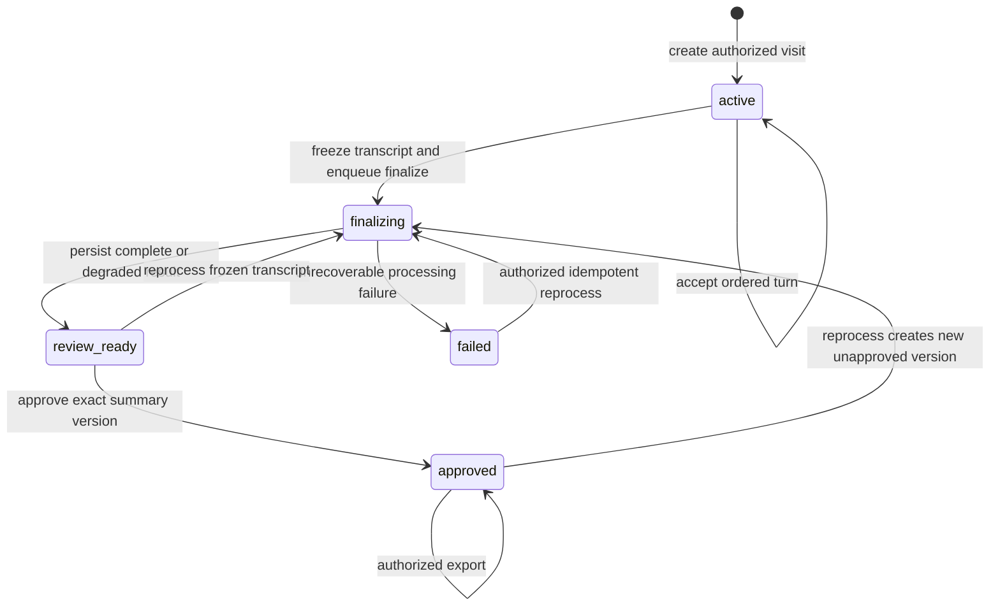

# API and event contracts

**Status: PROPOSED, not implemented.** Reviewed baseline: `b8e1b875809587aaebcde5bf5726ec1407d15264`, 2026-10-28. The current application exposes Python methods and a local audio WebSocket, not these HTTP endpoints. See [current interfaces](CURRENT-SYSTEM.md).

This is the target contract baseline for contributor discussion and implementation. An OpenAPI document, generated client, migrations, and executable contract tests must accompany implementation. Versioned behavior below prevents separate UI, worker, and persistence implementations from choosing incompatible semantics.

## Common contract

- Base path `/api/v1`; JSON request/response bodies; UTC ISO 8601 timestamps; opaque UUID identifiers. `tenant_id` comes from the authenticated server context, never a trusted client field. Display labels and external chart identifiers are not authorization keys.
- OIDC sign-in terminates in a server-managed session. Browser cookies are `Secure`, `HttpOnly`, and appropriately `SameSite`; mutating cookie-authenticated routes require CSRF protection. Validate session and per-visit authorization on every endpoint, event subscription, export, and audio connection.
- Initial roles: `clinician` manages assigned visits and approves summaries; `reviewer` reads assigned results but cannot approve/export as a clinician; `tenant_admin` manages membership and policy without automatically gaining visit-content access. Require explicit visit permission for content even for administrators. Patient/caregiver self-service accounts are deferred; participants are not implicitly API principals.
- All body-bearing mutation commands require an `Idempotency-Key`, scoped to tenant and visit (tenant and creator for visit creation), plus `expected_revision` for an existing visit. Store a request digest and response for the life of the visit. An identical retry returns the original operation/resource; a different payload under the same key is `409`.
- `revision` is the monotonic revision of the visit aggregate, incremented on durable mutations. `transcript_revision` is the latest accepted transcript revision. `processing_generation` starts at 1 and increments on each intentional reprocess; retries preserve it. `processed_through_revision` tracks the ordered analyzed prefix within that generation and may lag intake. Worker outputs identify generation, input transcript revision, result version, pack/profile versions, and algorithm version.
- Paginated endpoints use opaque cursors and bounded limits. Apply configurable body, text, visit-duration, request-rate and concurrent-connection limits before expensive processing. Never trust a client-supplied model, prompt, provider URL, storage key, or tenant identifier.
- Provider keys and provider error bodies are never returned to the client. Sanitize errors and trace IDs; detailed protected operational records must omit raw transcript/audio and secrets.

## HTTP resources

| Method and path | Request / result | Authorization and semantics |
| --- | --- | --- |
| `POST /visits` | Synthetic fixture/chart reference, pack/profile versions → `201`, visit ID, revision | Clinician; server verifies permitted dataset/source, snapshots profile/chart, status `active` |
| `GET /visits/{visit_id}` | Snapshot with revisions, lifecycle, processing coverage/errors and latest result metadata | Assigned clinician/reviewer; same tenant; does not expose unrelated visits |
| `POST /visits/{visit_id}/turns` | `expected_revision`, `client_turn_id`, `idx`, role, text, optional times → `201`, accepted turn and job ID | Clinician or bound internal relay; requires `active`; validates next contiguous `idx`; durable append and job in one transaction |
| `GET /visits/{visit_id}/turns?after_idx=...` | Bounded ordered page | Visit-content permission; only policy-permitted persisted text |
| `POST /visits/{visit_id}/finalize` | `expected_revision` → `202`, operation ID | Clinician; requires nonempty active visit; freezes transcript and transitions to `finalizing` |
| `GET /operations/{operation_id}` | Status `queued`, `running`, `succeeded`, `degraded`, or `failed`; sanitized error and result reference | Same tenant and permission on the operation's visit |
| `GET /visits/{visit_id}/flags` | Result version, verification status, evidence, review/dismissal state, detector coverage | Assigned clinician/reviewer; distinguishes incomplete analysis from no findings |
| `POST /visits/{visit_id}/flags/{flag_id}/reviews` | Expected revision/result version and action `dismiss` or `restore`, optional reason → `201` review action | Clinician; records immutable action, never erases model/evidence history |
| `GET /visits/{visit_id}/summary` | Draft/approved summary, version, input revision, readability, processing status | Assigned clinician/reviewer; no automatic external publication |
| `POST /visits/{visit_id}/summary/approvals` | Expected revision and exact summary version; explicit acknowledgment if degraded → `201` approval | Clinician; rejects changed, missing, or unreviewable version |
| `POST /visits/{visit_id}/reprocess` | Expected revision, reason → `202`, new operation and processing generation | Clinician; frozen transcript only; supersedes active jobs/results, resets processing frontier for replay, and requires renewed approval even for unchanged generated text |
| `POST /visits/{visit_id}/exports` | Expected revision, current approved summary version, format → `202`, export operation | Clinician with export permission; requires `approved` lifecycle and current generation; includes only permitted data; audit generation and download |
| `GET /exports/{export_id}/content` | Current approved version download after permission/state recheck | Reject after supersession, revocation or deletion; no public permanent URLs; short-lived retrieval, content headers and size limits |
| `POST /visits/{visit_id}/audio-tickets` | Expected revision, capture acknowledgment → short-lived one-use ticket | Clinician; active visit; approved audio policy; ticket bound to user/tenant/visit and allowed origin |
| `GET /visits/{visit_id}/events` | Authorized server-sent event stream | Visit permission rechecked on reconnect and periodically; revocation closes stream |

Tenant deletion/retention administration, chart-import contracts, role correction endpoints, and patient self-service are not specified as build-ready APIs here. Before implementing them, define authorization, audit, revision and deletion behavior in a new reviewed contract. Until a correction contract exists, reject mutation of accepted transcript content; create a new synthetic visit to correct it.

## Visit and turn examples

Illustrative synthetic payloads only. Server-generated identifiers are placeholders in these examples, not routable production IDs.

```json
{
  "synthetic_fixture_id": "demo-chest-pain",
  "pack_id": "chest_pain",
  "pack_version": "approved-demo-version",
  "profile_id": "hoh_lowlit_alone",
  "profile_version": "approved-demo-version"
}
```

The fixture registry resolves a chart snapshot. A future live chart import must use a different explicitly authorized path; it cannot be enabled by setting `synthetic` to false or relabeling raw content.

```json
{
  "expected_revision": 3,
  "client_turn_id": "browser-segment-0003",
  "idx": 2,
  "speaker": "patient",
  "text": "Could you repeat the last part?",
  "t_start": 12.0,
  "t_end": 14.5
}
```

```json
{
  "visit_id": "0b0b4912-7c22-455b-947a-1300b62f72d7",
  "revision": 4,
  "transcript_revision": 3,
  "processing_generation": 1,
  "processed_through_revision": 1,
  "accepted_idx": 2,
  "processing": "queued",
  "operation_id": "8155c3ef-8aad-4538-8fe4-bb1f4cc415ef"
}
```

Uniqueness on `(visit_id, idx)` and `(visit_id, client_turn_id)` supplements the idempotency ledger. Repeated identical segments return the original acceptance; conflicting content is `409`. An initial turn must have index zero. Clients must resolve conflicts from the returned authorized snapshot instead of guessing the next index. Segments from parallel capture streams cannot compete to assign authoritative turn order: the intake service serializes them.

## Visit lifecycle

**PROPOSED.** Processing outcome is separate from the lifecycle; `review_ready` may have a visibly degraded analysis outcome.



There is no automatic transition from `failed` to a successful empty result. There is no reopen/edit-after-finalize command in this contract. Future amendment workflows must explicitly create a new transcript revision, invalidate affected result approvals, and preserve old evidence references. Historical approvals remain audit/review records; historical export is outside the initial API. An export worker and its download handler recheck the current approved generation. Previously downloaded files are outside the service's recall capability.

## Event and job envelopes

An event records a committed state change. Use `visit.turn.accepted`, `visit.processing.updated`, `visit.result.ready`, `visit.review.recorded`, `visit.summary.approved`, and `visit.export.ready`. A worker writes a result and its outbox event in the same transaction.

```json
{
  "schema_version": 1,
  "event_id": "eb25dad5-d481-40b4-a1c0-3aa13b619d6c",
  "event_type": "visit.result.ready",
  "visit_id": "0b0b4912-7c22-455b-947a-1300b62f72d7",
  "revision": 12,
  "transcript_revision": 8,
  "processing_generation": 1,
  "processed_through_revision": 8,
  "operation_id": "8155c3ef-8aad-4538-8fe4-bb1f4cc415ef",
  "occurred_at": "2026-10-28T15:00:00Z",
  "data": {"result_version": 1, "processing": "degraded"}
}
```

The SSE `id` is `event_id`; the server keeps an internal ordered cursor scoped to the visit. Clients deduplicate event IDs and refresh a snapshot when they see a revision gap. `Last-Event-ID` resumes within retention; an expired or foreign cursor returns `409 resync_required` without revealing other visits. Stream delivery is at-least-once, not authoritative storage. Push events carry references/status, not full clinical content.

Internal jobs additionally contain tenant ID, job type, processing generation, target transcript revision, expected prior processed-through revision, pack/profile versions, model/prompt/schema/policy versions, attempt count, lease/fencing token and trace ID. They must not carry raw patient content in queue messages or tracing baggage. Workers load the authorized immutable snapshot through the persistence adapter. Uniqueness includes generation, target revision, job type and algorithm version, so intentional reprocessing is distinct from delivery retries.

A per-turn commit checks active generation, lease and expected prior processed frontier; its target may be below the accepted frontier when intake gets ahead. It advances the processed frontier in order rather than overwriting newer results. Finalize waits for the frozen prefix or computes that complete prefix in one fenced job. A superseded generation, invalid lease, changed frozen input, revoked/deleted visit or already-advanced processed frontier rejects the commit. A duplicate completed job reuses the recorded result. Snapshot/event consumers must display processing lag and generation explicitly.

## Audio WebSocket

**PROPOSED path:** `wss://<application-host>/api/v1/visits/{visit_id}/audio`. The current `ws://localhost:8765` protocol remains documented in [CURRENT-SYSTEM.md](CURRENT-SYSTEM.md) and is not suitable as the remote contract.

1. Validate the `Origin` allowlist and connection limits at upgrade. The browser presents the one-use audio ticket in the first control frame within a short timeout; do not put long-lived credentials in URL query strings. Verify session, tenant, visit, expiration, single-use status and active capture consent before accepting audio. Close unauthenticated streams before forwarding any bytes.
2. Negotiate a bounded allowlist of codec/sample-rate/channel combinations supported by the chosen speech adapter. The server accepts a `start` control frame with `capture_session_id`, codec and sequence context, then ordered binary frames; no arbitrary provider configuration is accepted.
3. Use monotonically increasing chunk sequence numbers within the capture session. Responses include acknowledgments, interim display-only transcript, finalized segments with stable `segment_id`, and sanitized errors. Only finalized, role-confirmed segments become turns.
4. Emit `backpressure` before bounded queues overflow; stop capture if the client ignores it. Apply maximum duration, frame size, inactivity and token budget limits. Drop or mark missing audio explicitly; never claim gap-free capture after loss.
5. Reconnection needs a new ticket and the last acknowledged sequence/segment. The server deduplicates finalized segments and reports unrecoverable capture gaps. Buffers are memory-bounded and erased on close; raw recording storage requires a separately approved feature.
6. Revoked access, consent withdrawal, visit finalization or expired authorization terminates capture and provider forwarding. No process-global queue may mix visits. Speaker labels alone do not establish clinician/patient identity.

## Errors and degradation

```json
{
  "error": {
    "code": "revision_conflict",
    "message": "Refresh the visit before submitting this change.",
    "trace_id": "3cc8f4a5e38b4c2bb7f496be847f830a",
    "retryable": false
  }
}
```

| HTTP status | Meaning | Client behavior |
| --- | --- | --- |
| `400` / `422` | Invalid schema, speaker, sequence, timestamps or unsupported operation | Correct input; do not retry unchanged |
| `401` | No valid session | Reauthenticate; do not replay capture automatically |
| `403` / `404` | Not permitted, or resource not visible | Do not disclose cross-tenant existence; stop the action |
| `409` | Revision, lifecycle or idempotency conflict; expired event cursor | Refresh authorized state, reconcile, issue a new intentional command |
| `413` | Payload exceeds policy | Reduce permitted input size; no automatic splitting that changes semantics |
| `429` | Admission/rate budget exceeded | Honor `Retry-After`, bounded backoff; show delay |
| `503` | Temporarily unable to accept work durably | Retry with the same idempotency key; never claim acceptance |

After durable acceptance, provider failure is normally recorded on the operation/result, not transformed into a second HTTP error for an already successful append. Per-detector outcomes are `pending`, `complete`, `failed`, or `disabled`; zero flags only means no retained flags from completed checks. This extends the current `VisitState.errors` model without treating failure as safe completion.

## Required implementation tests

Before enabling this API, verify cross-tenant and unassigned-user denial; CSRF/session revocation; duplicate and conflicting idempotency keys; turn gaps and racing appends; finalize racing with the last turn; worker crash after provider call and before commit; stale result fencing; out-of-order/duplicate event recovery; expired audio ticket and wrong Origin; cross-session audio separation; provider outage/degraded UI; and approval/export of an outdated summary version. These tests are requirements for future code, not tests added or passed by this documentation change.
