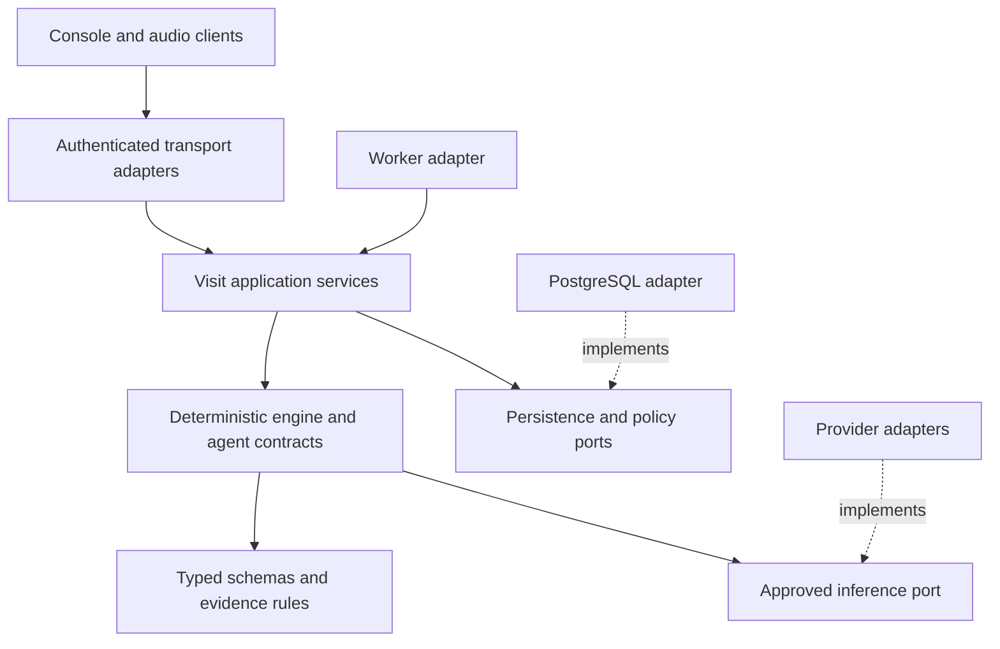

# Architecture decisions

This document records current constraints and proposed cross-component rules. **Final** means this documentation is complete; it does not mean the proposed implementation has been approved or deployed. `[ADOPTED]` denotes existing project intent supported by the repository. `[PROPOSED]` denotes the recommended service design. Current enforcement gaps are documented in [current system](CURRENT-SYSTEM.md).

## Design paradigm

Preserve the deterministic Python pipeline within a modular application. In the proposed design, transport, data stores and providers implement adapters; orchestration owns workflow and typed contracts. Dependencies point inward. Agents do not authorize users, commit database transactions, or call arbitrary providers.

## Invariants and rules

### AD-1 — Synthetic research and human responsibility [ADOPTED]

- **Binds:** every input, demonstration, evaluation and output surface.
- **Prevents:** a prototype fixture or generated flag being treated as validated clinical evidence or autonomous advice.
- **Rule:** maintain synthetic-only scope and documentation-completeness semantics; never present diagnosis/treatment recommendations or a compliance claim. A schema's synthetic marker is a declaration, not provenance proof. Non-synthetic use requires a separately approved release gate and reviewed input/provider/retention policies.

### AD-2 — Typed deterministic domain boundary [ADOPTED / PROPOSED]

- **Binds:** console, engine, agents, providers and storage.
- **Prevents:** separate UIs/providers inventing incompatible flag shapes or embedding workflow inside prompts.
- **Rule:** implemented domain shapes remain owned by `src/schemas.py`; the engine controls timing and state transitions. Target transport/persistence DTOs are explicitly mapped and versioned rather than silently modifying domain schemas. Provider access belongs behind adapters; no agent owns authentication or direct persistent state.

### AD-3 — Ordered visit ownership and version fencing [PROPOSED]

- **Binds:** intake, API, relay, workers and persistence.
- **Prevents:** duplicate turns, simultaneous finalization, stale result overwrite and double-emitted findings.
- **Rule:** a tenant-scoped visit has one logical state writer at a time. Start indices at zero and accept contiguous turns atomically with jobs. Enforce idempotency and expected revisions as defined in `API-CONTRACTS.md`. Track accepted and processed-through transcript revisions separately; ordered prefix jobs may advance processing while intake is ahead. Finalize the frozen complete prefix. Intentional reprocess increments processing generation; retry does not. Job identity and commit fences include generation, lease and expected prior processed frontier; superseded work cannot become current output.

### AD-4 — Evidence, timing and explicit uncertainty [ADOPTED / PROPOSED]

- **Binds:** detection, verification, summary, evaluation and console.
- **Prevents:** omissions raised too early, invented evidence and unavailable analysis shown as no gaps.
- **Rule:** keep checklist/concern omissions at finalization; use passive indicators during a visit. Preserve source references and verbatim evidence checks. Keep unverified outputs distinguishable; record detector failure separately from zero findings. Target results bind to immutable input and pack revisions. Model verification is separate from clinician review and summary approval; initial exports require the current generation's exact approved version, with permission and lifecycle rechecked at generation and download.

### AD-5 — One enforceable egress policy [PROPOSED]

- **Binds:** text inference, role classification, speech, summaries, exports and evaluation credentials.
- **Prevents:** DEMO/privacy guarantees bypassed by alternate call paths or unapproved fallback providers.
- **Rule:** every external call passes an approved adapter and data-class policy. Scrub/minimize text before permitted hosted inference and fail closed on preparation failures. Raw audio requires separate consent/policy because it precedes text scrubbing. Network-free demo mode blocks every optional egress path. Fallback cannot change approved provider/data-residency scope silently.

### AD-6 — One durable authority and tenant-scoped references [PROPOSED]

- **Binds:** API, workers, evaluation separation, database, cache and object storage.
- **Prevents:** filesystem/queue/cache state conflicting with accepted visit state or leaking between tenants.
- **Rule:** PostgreSQL owns accepted visits, turns, result versions, review actions, jobs and audit metadata. Persist state and outbox atomically. Enforce tenant-scoped keys/references and explicit visit permissions; runtime roles cannot bypass isolation policies. Objects contain only policy-approved artifacts, accessed through authorization. Caches are bounded, expiring, tenant-scoped and non-authoritative. Synthetic evaluation files remain isolated from service data.

### AD-7 — Identity and connection isolation [PROPOSED]

- **Binds:** browser, API, audio relay, event stream, identity and export adapters.
- **Prevents:** ambient administrator/content access, shared microphone queues and leaked provider credentials.
- **Rule:** derive identity/tenant from a validated server session and check object permission on every access. Use the roles and permissions in `API-CONTRACTS.md`. Use TLS, CSRF protection and origin checks. Bind short-lived one-use audio tickets to the user/tenant/visit and isolate all buffers per capture. Revocation terminates access. Provider credentials remain server-side.

### AD-8 — Reproducible isolated operation [PROPOSED]

- **Binds:** CI, environments, deployment, telemetry and recovery.
- **Prevents:** synthetic/live data mixing, irreproducible releases and untested recovery assumptions.
- **Rule:** separate development, synthetic staging and any later approved pilot identities, secrets, storage and quotas. Pin tested dependencies/model/prompt/schema/pack versions per release. Use sanitized metadata for telemetry, never raw clinical content. Require restore exercises, migration/rollback procedures and measured quality/availability gates before advancing beyond synthetic demonstrations.

## Consistency conventions

| Concern | Target convention |
| --- | --- |
| Identifiers and time | Opaque UUID entity IDs; UTC ISO 8601 timestamps; domain evidence turn references remain explicit indices within a transcript revision |
| Versions | Visit aggregate revision, accepted and processed transcript frontiers, processing generation, result version and pack/profile versions are distinct; carry all needed provenance |
| Errors | Classified safe error envelope; persist asynchronous processing status; no raw provider bodies or secrets in logs |
| Mutation | Commands through application service; idempotency ledger and transactional outbox; at-least-once job/event delivery tolerated |
| Ownership | Authentication does not imply access to a visit; tenant admin role does not automatically expose visit content |
| Approval | A summary approval applies to one exact immutable version; regenerated content requires renewed review |

## Structural seed and traceability

The [current inventory](CURRENT-SYSTEM.md) records observed dependency constraints, including unpinned packages; no reproducible lock is claimed. The [solution design](SOLUTION-DESIGN.md) carries component/data-flow views, the [data model](DATA-AND-SECURITY.md) carries proposed entity relationships, and [operations](OPERATIONS-AND-ROADMAP.md) carries deployment and environment boundaries. These documents collectively cover workflow, interfaces, data, security, infrastructure and quality; code owns implemented detail as it evolves.

| Area | Governing decisions |
| --- | --- |
| Four gap detectors and accessible summaries | AD-1, AD-2, AD-4 |
| Typed, replayed and speech input | AD-1, AD-3, AD-5, AD-7 |
| API, worker and database ownership | AD-2, AD-3, AD-6 |
| Provider integration and data protection | AD-1, AD-5, AD-6, AD-7 |
| Deployment, scalability, evaluation and operations | AD-3, AD-6, AD-8 |

## Deferred

- **Cloud vendor, exact new package/database versions and capacity:** choose and pin at implementation after provider, budget and workload constraints are known; adapter and ownership rules already apply.
- **Production browser framework:** decide after accessibility and audio/session prototypes; the API boundary remains stable.
- **Non-synthetic use and jurisdiction:** blocked for that future phase until approved data, consent, retention, vendor and clinical policies exist. This does not block synthetic development.
- **Broker and multi-region topology:** add only on measured need and agreed recovery objectives; durable state and ordering rules remain unchanged.
- **EHR write-back, RAG, new clinical packs and patient accounts:** separate capability proposals with permission, provenance and clinical review requirements. None is implied by the current synthetic FHIR importer.
- **Transcript corrections and retention-admin APIs:** define reviewed amendment/deletion contracts before implementing them; current proposed API rejects in-place accepted-content mutation.
