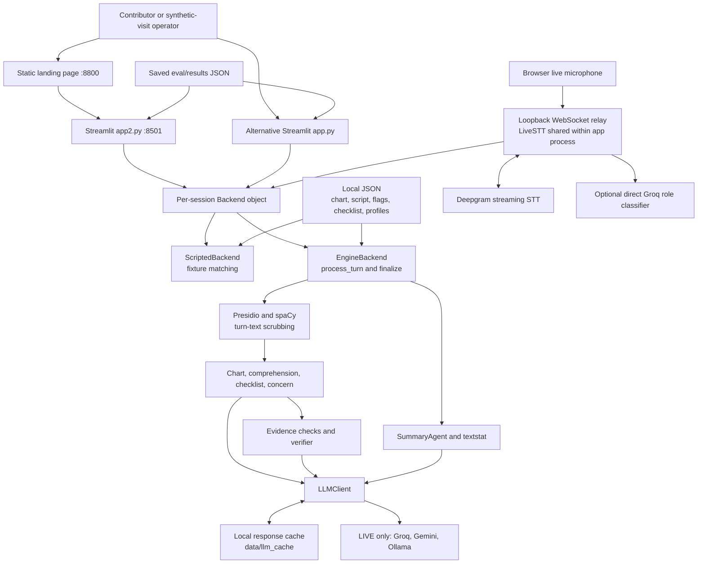
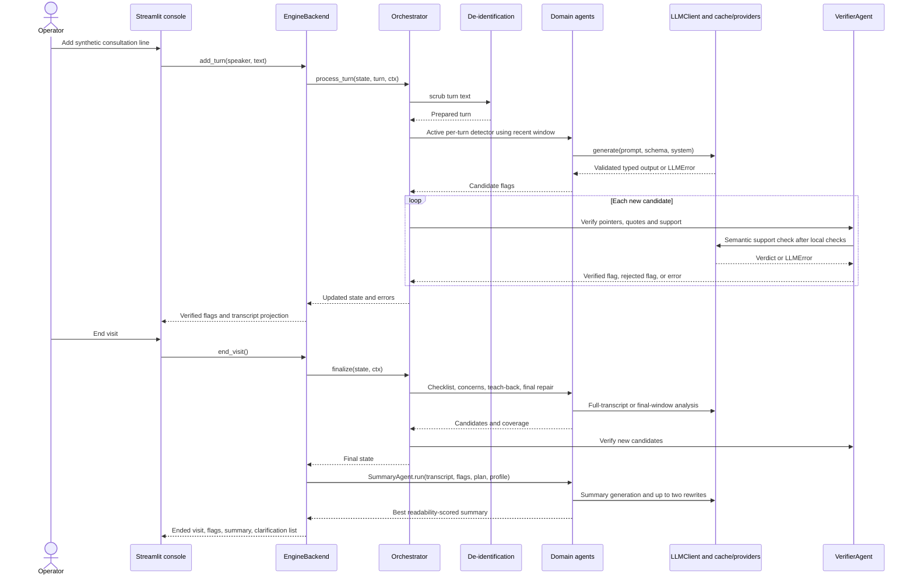

# Current system architecture

Reviewed on **2026-10-28** against commit [`b8e1b875809587aaebcde5bf5726ec1407d15264`](https://github.com/darpan02-cypher/Dr.Listner/tree/b8e1b875809587aaebcde5bf5726ec1407d15264).

This document describes the inspected implementation. Dr.Listner is a Python and Streamlit research prototype for identifying documentation and communication gaps in **synthetic** consultations. It is not a validated clinical system. Proposed services, authenticated APIs, databases, or infrastructure in companion documents are future designs, not deployed capabilities established by this review.

## System shape

The application is a modular monolith. Streamlit renders the console and calls ordinary Python backend methods in the same process. Domain agents receive typed inputs and an LLM interface; a deterministic orchestrator decides when they run. There is no separate REST application server, durable visit database, background job queue, or live EHR connection in the inspected runtime.

The local launcher starts a static landing page and the newer console. Optional live transcription adds a WebSocket relay in a daemon thread. Model requests are synchronous HTTP calls. Local JSON files provide charts, profiles, checklists, cached model outputs, and saved evaluation results.

The direct role-classifier path is deliberately separate from `LLMClient`: it does not inherit that client's DEMO restriction or de-identification path. The diagram groups provider connections for readability; their endpoints are listed below.

## Component inventory and ownership

| Component | Implemented responsibility | Main source |
| --- | --- | --- |
| Landing page | Static introduction; Launch Console points at `http://localhost:8501` | [landing/index.html](../../landing/index.html#L423) |
| Current console | Dashboard, transcript, flags, patient summary, microphone, visit controls; optional developer controls | [app2.py](../../app2.py#L120) |
| Alternative console | Tabbed live visit, wrap-up, patient, and evaluation views; backend choices exposed in sidebar | [app.py](../../app.py#L44) |
| Backend interface | Holds turns, flags, coverage, errors, summary, and ended state; exposes `add_turn`, `end_visit`, `dismiss` | [demo/backend.py](../../demo/backend.py#L32) |
| Scripted backend | Matches supplied text against a prepared script and emits fixture-defined coverage, flags, and summary | [demo/backend.py](../../demo/backend.py#L58) |
| Engine backend | Owns `VisitState` and `EngineContext`; invokes real agents and synchronizes their output into UI state | [demo/backend.py](../../demo/backend.py#L133) |
| Orchestrator | Enforces turn order, applies scrubbing, schedules detectors, deduplicates flags, verifies candidates, records model errors | [src/engine.py](../../src/engine.py#L81) |
| Domain schemas | Pydantic models for turns, transcripts, charts, profiles, flags, evidence, visit state, and evaluation output | [src/schemas.py](../../src/schemas.py) |
| Agent modules | Typed prompt construction, response validation, evidence extraction, summary readability loop | [src/agents](../../src/agents) |
| LLM client | Cache-first generation, provider selection, JSON validation, retries, fallback, response caching | [src/llm/client.py](../../src/llm/client.py#L53) |
| De-identification | Presidio and spaCy replacement of selected identifier entities in engine turn text | [src/deid.py](../../src/deid.py#L45) |
| STT relay | Browser PCM forwarding, Deepgram transcript handling, speaker-role mapping, utterance aggregation | [src/stt_deepgram.py](../../src/stt_deepgram.py#L45) |
| Pack loader | Loads the chest-pain checklist and patient profiles from local files | [src/pack.py](../../src/pack.py) |
| Evaluation display | Reads already-saved JSON reports; it does not execute or score evaluations | [app2.py](../../app2.py#L296), [app.py](../../app.py) |

`VisitState` owns the engine transcript and candidate outcomes; `EngineContext` also accumulates pre-verification candidates. These are in-memory Python objects, not independently deployed agents or services. `process_turn` returns a copied state but mutates the context's candidate list, so it is not wholly side-effect-free. The UI backend's `flags` list is a projection of verified state flags.

## Entry points and operating modes

| Choice | Actual behavior | Important boundary |
| --- | --- | --- |
| `run.sh` | Starts `http.server` for `landing/` on 8800 and `streamlit run app2.py` on 8501 | Local development launcher; no production process supervisor or TLS configuration |
| `streamlit run app2.py` | Defaults to Scripted backend and DEMO mode; live microphone orb is available during a visit | `?dev=1` reveals backend/mode/rehearsal/evaluation controls; it is a display switch, not authorization |
| `streamlit run app.py` | Alternative tabbed console with backend/mode controls and explicit live mic selection | Default STT relay port is 8765 |
| Scripted backend | No inference for gap detection or summary; outputs are fixture driven | Optional microphone/STT paths may still use external services |
| Engine + DEMO | Real agent orchestration; `LLMClient` returns valid cached outputs only, raises `DemoCacheMiss` for misses | Cache hits require the same model, system text, prompt, and schema; this does not make microphone processing offline |
| Engine + LIVE | Cache first; then configured providers in order | Default order is Groq, Gemini, Ollama; missing keys or provider failures can trigger fallback |

`app2.py` sets `STT_PORT=8766` only when the environment has not already set it, avoiding the older console's default port. It uses `DRL_BACKEND` and `DRL_MODE` for its initial UI settings. `DRLISTNER_MODE` is the LLM client's default when a caller does not pass an explicit mode; these are distinct settings ([app2.py](../../app2.py#L14), [src/config.py](../../src/config.py#L35)).

Both UIs store the backend in `st.session_state`, while `LiveSTT` is constructed with `@st.cache_resource`. That STT object, its queue, and its speaker mapping are shared across sessions in the same app process. This topology supports a controlled local demonstration, not isolated concurrent visits ([app2.py](../../app2.py#L104), [app.py](../../app.py#L34)).

## Visit workflow

### Start and input

1. Load the synthetic chart, checklist, script, flags/plan items, and selected patient profile. Create a Scripted or Engine backend.
2. Accept a typed clinician/patient line, a browser speech-to-text result, a rehearsal line, or a completed live-STT utterance. The input wrapper ignores blank input and input after the visit ends.
3. Assign the next turn index from the current turn count. Engine processing checks that subsequent indices are contiguous.
4. On an Engine path, scrub turn text before adding it to the engine transcript. The chart itself and supplied plan items do not pass through this turn scrubber.

The demonstration uses a fixed visit ID from `demo/script.json`, not a generated durable encounter identity. The newer UI excludes caregiver-present profiles; its typed controls offer clinician and patient. The schema and some agents support caregiver turns, but live speaker mapping supports only clinician and patient ([app2.py](../../app2.py#L105), [demo/backend.py](../../demo/backend.py#L152), [src/stt_deepgram.py](../../src/stt_deepgram.py#L24)).

### Detection and wrap-up

| Stage | Implemented rule |
| --- | --- |
| Per-turn chart check | Runs on non-clinician turns when enabled in the profile; compares the focus turn and recent context with chart entries |
| Per-turn comprehension check | Runs after clinician turns when at least two turns exist; checks for an earlier unaddressed comprehension problem |
| Context window | Last five turns for per-turn detectors |
| Wrap-up recognition | A regex records `wrapped_up`; it does not itself run omission detectors |
| Explicit finalization | Runs checklist omissions, unanswered concerns, teach-back, and a final comprehension repair check according to active detector types |
| Deduplication | Chart contradictions deduplicate by referenced chart entries; other flags deduplicate by evidence source/reference tuples |
| Verification | Valid pointers and verbatim source quotes, an advice-wording check, then an LLM support verdict |
| Verifier failure | A programmatically valid candidate may remain in engine state as unverified; `EngineBackend._sync` filters it out of displayed flags |
| Detector failure | Adds an error rather than treating failure as evidence of no gaps |
| Summary | Uses final transcript, verified flags, fixture plan items, and profile targets; chooses the best grade/word-limit score over at most three attempts |

Evidence: [orchestration](../../src/engine.py#L81), [finalization](../../src/engine.py#L119), [verifier](../../src/agents/verifier.py#L37), [UI projection](../../demo/backend.py#L146), [summary loop](../../src/agents/summary.py#L56).

The engine does not retract earlier flags if later turns repair the situation. The finalization function also does not prevent subsequent direct Python calls to `process_turn`; the UI's `ended` guard supplies that restriction. `dismiss` updates backend display state, not engine state, and a later `_sync` would restore the engine projection. These ownership differences matter when converting the prototype into a durable API.

The newer console's gap-check buttons filter displayed flags and transcript highlights. They do not update the profile's `active_detectors` and therefore do not disable inference calls ([app2.py](../../app2.py#L206), [app2.py](../../app2.py#L251), [app2.py](../../app2.py#L378)).

### Scripted workflow

`ScriptedBackend` searches the next six prepared script entries for a same-speaker text match and accepts a `difflib.SequenceMatcher` ratio of at least 0.6. A match advances the script pointer and emits fixture coverage/flags; an unmatched turn is recorded as off-script. End-of-visit flags with transcript evidence are emitted only when their referenced script turns were matched. The summary and clarification list come from `demo/flags.json`. A fixture flag's `verified=True` is predetermined demonstration output, not a fresh verifier decision ([demo/backend.py](../../demo/backend.py#L66)).

### Live speech workflow

1. JavaScript requests browser microphone access, downsamples to mono 16 kHz signed 16-bit PCM, and sends binary chunks to `ws://127.0.0.1:PORT`.
2. The local relay opens a TLS WebSocket to Deepgram using a server-side environment key, requests diarization/interim results, and forwards the audio.
3. Final transcript messages are split into runs by speaker ID and placed in `LiveSTT.finals`; partial results remain transient UI state.
4. `collect` aggregates fragments into utterances, releasing on punctuation, certain speaker/reply boundaries, or 2.5 seconds of idle time. UI fragments poll approximately once per second.
5. First distinct voice maps to clinician, second to patient; further IDs inherit a preceding role. With fewer than two detected voices, an optional direct Groq request classifies the new line using up to eight recent turns. It falls back to a question/first-role heuristic when classification is unavailable.
6. Completed text enters `Backend.add_turn`; de-identification occurs only later if the selected backend is Engine.

The browser's loopback address refers to the browser's own machine. A remote Streamlit server does not make this local WebSocket relay reachable from a visitor's browser. There is no session token, origin allowlist, or visit routing in the relay. `reset_speakers` clears the mapping and partial result but does not drain the final queue or pending utterance, so reset/end handling also needs redesign before concurrent or persistent use ([src/stt_deepgram.py](../../src/stt_deepgram.py#L70), [relay](../../src/stt_deepgram.py#L139), [browser transport](../../src/stt_deepgram.py#L222)).

The separate `streamlit-mic-recorder` `speech_to_text` widget and browser `speechSynthesis` read-aloud feature depend on browser capabilities. Their data processing and availability should be verified for the supported browser/platform; they are not the Deepgram relay or server-side TTS ([app2.py](../../app2.py#L273), [app2.py](../../app2.py#L311)).

## Existing interfaces and external integrations

### Internal Python contracts

| Interface | Inputs | Output / error semantics |
| --- | --- | --- |
| `Backend.add_turn(speaker, text)` | Speaker string and text | `Turn`; mutates backend projection |
| `Backend.end_visit()` | Existing visit | Sets ended state, flags, coverage, summary and clarifications; empty engine transcript is invalid |
| `Backend.dismiss(flag_id)` | Flag identity | Marks matching display flags dismissed |
| `engine.new_state(visit_id, profile)` | Visit identity and profile | Empty `VisitState` |
| `engine.process_turn(state, turn, ctx=None)` | State, next turn, optional engine context | Copied state; no context means record only; out-of-order turns raise `ValueError` |
| `engine.finalize(state, ctx)` | Nonempty transcript and context | Final analysis state; model failures collected in `errors` |
| `engine.run_batch(state, turns, ctx=None)` | Iterable of turns | Folded state; finalizes only when context is supplied |
| `LLM.generate(prompt, schema, system=None)` | Prompt, Pydantic model class, optional system prompt | Validated model instance, `DemoCacheMiss`, or `LLMUnavailable` / `LLMError` |
| `LiveSTT.collect(history)` | Recent role/text history | List of completed role/text utterances |

These are in-process interfaces, not public network endpoints. There is no application-defined OpenAPI contract in the inspected code. Streamlit manages its own browser/server protocol.

### Network integrations

| Integration | Endpoint and transport | Payload / behavior |
| --- | --- | --- |
| Groq inference | `POST https://api.groq.com/openai/v1/chat/completions` | Bearer key; model, messages, temperature 0, JSON-object response mode |
| Gemini inference | `POST https://generativelanguage.googleapis.com/v1beta/models/{model}:generateContent` | `x-goog-api-key`; contents, optional system instruction, JSON MIME response |
| Ollama inference | `POST {OLLAMA_URL}/api/chat` | Local default; messages, non-streaming result, schema in `format`; no authentication supplied by this adapter |
| Deepgram STT | `wss://api.deepgram.com/v1/listen` | Token header; binary PCM; English, diarization, smart formatting, interim results, 700 ms endpointing |
| Role classification | Direct Groq chat-completions POST | Up to eight history turns and new text; 10-second timeout; one-word clinician/patient result |
| Browser-to-relay | `ws://127.0.0.1:{STT_PORT}` | Binary PCM; no application authentication or visit identifier |

Provider endpoint evidence: [LLM adapters](../../src/llm/client.py#L134), [Deepgram parameters](../../src/stt_deepgram.py#L29), [role classifier](../../src/stt_deepgram.py#L187).

`LLMClient` first looks for schema-valid cache entries for every configured provider model, then tries live providers if allowed. A later provider's cache entry can therefore avoid an earlier provider's live call. Each provider defaults to three attempts with exponential waits for transient/network or invalid-output failures. The request timeout is 60 seconds, tripled for Ollama. Groq 429 responses can supply a bounded numeric `Retry-After` delay. Calls block the executing UI/script path; there is no overall visit deadline or circuit breaker ([src/llm/client.py](../../src/llm/client.py#L80)).

## Runtime dependencies and configuration

Declared dependencies are evidence of intended installation, not an observed deployed version set. Most requirements are unpinned; no runtime lockfile establishes a reproducible resolution.

| Dependency | Use | Declared constraint |
| --- | --- | --- |
| Python | Application/runtime language | No exact interpreter pin in the inspected runtime requirements |
| Streamlit | UI, session state, fragments, embedded components | Unpinned |
| `streamlit-mic-recorder` | Optional browser speech widget | Unpinned |
| `websockets` | Deepgram client and local relay server | `>=13` |
| Pydantic | Domain contracts and LLM output validation | `>=2.6` |
| `requests` | Synchronous provider HTTP clients | Unpinned |
| `presidio-analyzer`, `presidio-anonymizer` | Turn-text identifier detection/replacement | Unpinned |
| spaCy | English NLP backend | `>=3.8,<3.9` |
| `en_core_web_sm` | English NLP model | Direct wheel URL for 3.8.0 |
| `textstat` | Flesch-Kincaid summary grade | Unpinned |
| pandas | Saved evaluation tables | Unpinned |

Source of declared constraints: [requirements.txt](../../requirements.txt). Development/evaluation dependencies are separate in [requirements-dev.txt](../../requirements-dev.txt).

| Setting | Default / meaning |
| --- | --- |
| `DRL_BACKEND` | `Scripted`; initial backend for `app2.py` |
| `DRL_MODE` | `DEMO`; explicit initial engine mode in `app2.py` |
| `DRLISTNER_MODE` | `DEMO`; default mode for callers constructing `LLMClient` without a mode |
| `LLM_PROVIDERS` | `groq,gemini,ollama`; provider names/order |
| `GROQ_MODEL` | `openai/gpt-oss-120b` |
| `GEMINI_MODEL` | `gemini-2.5-flash` |
| `OLLAMA_MODEL` | `qwen2.5:7b` |
| `OLLAMA_URL` | `http://localhost:11434` |
| `GROQ_API_KEY`, `GEMINI_API_KEY` | Required for the corresponding hosted inference adapter |
| `DEEPGRAM_API_KEY` | Environment key for live STT |
| `DEEPGRAM_MODEL` | `nova-3` |
| `ROLE_MODEL` | `openai/gpt-oss-20b`; separate role-classifier model |
| `STT_PORT` | 8765 in STT module; `app2.py` sets 8766 if unset |

These model names are **code defaults at the reviewed commit**, not guarantees of present provider availability, account entitlement, or approved data handling. Check and record live compatibility before enabling a provider. Configuration is loaded at module import; restart the process after changing relevant environment settings.

`src/config.py` loads an optional root `.env` without overwriting existing environment variables. Inference adapters retrieve secrets from environment variables, then Streamlit secrets. STT and role classification use `os.environ` directly. Streamlit can expose root-level secrets as environment variables; nested secret sections and standalone execution require explicit environment injection for those paths. This configuration behavior was checked against documentation, not a live speech integration. Do not publish real keys in examples ([src/config.py](../../src/config.py#L11), [src/stt_deepgram.py](../../src/stt_deepgram.py#L139), [Streamlit secrets behavior](https://docs.streamlit.io/develop/concepts/connections/secrets-management)).

## Current limitations that constrain the target design

1. **Synthetic scope is a declared contract, not content verification.** `Transcript.synthetic` and `Chart.synthetic` require the value `True`, but the UI accepts arbitrary speech and text. The schema cannot prove that content is synthetic ([src/schemas.py](../../src/schemas.py#L25)).
2. **De-identification covers a limited path.** Engine turn text is scrubbed; raw audio reaches Deepgram, role classification can send raw recent text to Groq, charts/plan items bypass the turn scrubber, and Scripted stores input directly. Dates are deliberately retained, and statistical entity detection is not a removal guarantee ([src/deid.py](../../src/deid.py)).
3. **The cache is plaintext response storage.** Keys hash model/system/prompt/schema, but cached responses may contain transcript quotations or summaries. Not storing the prompt does not make cache contents non-sensitive. Writes have no TTL, tenant partition, or atomic-write mechanism ([src/llm/client.py](../../src/llm/client.py#L223)).
4. **Visit state is ephemeral and STT state is shared.** A restart loses live visit state. Cached STT state has no visit/user routing, and a new visit does not fully flush audio/text state.
5. **No application authentication or authorization boundary is implemented.** The Clinician/Patient view selector and `?dev=1` are UI choices. The loopback relay has no session checks. Authentication, policy enforcement, and durable audit history are target work.
6. **Error visibility differs by UI.** `app.py` displays backend errors in the sidebar. `app2.py` shows engine notes only inside its developer status panel; ordinary users can see an empty flag list without that diagnostic. A production design must keep incomplete analysis visible ([app.py](../../app.py#L81), [app2.py](../../app2.py#L419)).
7. **Readability is not factual verification.** Summary generation optimizes grade and length with bounded retries. It does not guarantee plan coverage, factual correctness, or a clinically reviewed output ([src/agents/summary.py](../../src/agents/summary.py#L56)).
8. **Clinical content remains research material.** Checklist citation status, comprehension heuristics, synthetic benchmark results, and LLM support checks do not establish clinical validity. The UI itself describes the checklist as not clinician-reviewed.
9. **No production deployment is established by source inspection.** A launcher and hosting instructions do not prove a running service, approved provider accounts, configured TLS, backups, monitoring, or operational readiness.

## Maintainer update rule

Update this document when changing an entry point, provider path, data owner, mode meaning, input transport, or agent timing. Update diagrams and source links in the same pull request. Preserve the distinction between implemented behavior and target designs; refresh the reviewed commit when the described code changes. Validate synthetic typed/Scripted behavior separately from credentialed speech and LIVE integrations.
