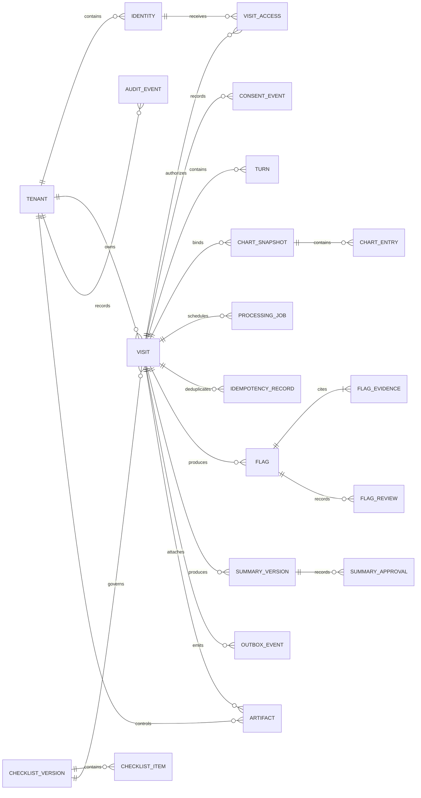

# Data architecture, security, and evaluation

Reviewed **2026-10-28** against commit `b8e1b875809587aaebcde5bf5726ec1407d15264`.

**CURRENT** describes inspected code. **PROPOSED** describes a design for a future authenticated service; no database migration, identity service, or security control is implemented by this documentation. This project currently supports a synthetic-data demonstration and research evaluation. Its evidence does not establish suitability for clinical use.

## Current data contracts

The application uses Pydantic models and JSON files, with visit state held in the Python process. There is no application database, ORM, migration system, or repository-level database deployment configuration in the reviewed tree.

| Contract | Meaning and enforced checks | Source |
| --- | --- | --- |
| `Turn`, `Transcript` | Turn index, clinician/patient/caregiver speaker, nonempty text, optional times; transcript indices must be contiguous from zero and end time cannot precede start time | [schemas.py](../../src/schemas.py#L11) |
| `Chart`, `ChartEntry` | Chart identifier, age, sex, entries containing resource type, display, status/date, optional original FHIR dictionary | [schemas.py](../../src/schemas.py#L44) |
| `Flag`, `EvidencePointer` | Four gap types; evidence references a transcript turn, chart entry, or checklist item. Transcript/chart evidence requires a quote. Each gap type requires particular evidence sources | [schemas.py](../../src/schemas.py#L65) |
| `Checklist`, `ChecklistItem` | Versioned checklist, unique item IDs, verification label and note; a `VERIFIED` item requires a guideline reference | [schemas.py](../../src/schemas.py#L111) |
| `PatientProfile`, `VisitState` | Detector selection, hearing/literacy/caregiver settings, summary targets; turns, coverage, flags, wrap-up status, and errors | [schemas.py](../../src/schemas.py#L185) |
| `AnswerKey`, `PlantedGap`, `PlanItem` | Synthetic development/test ground truth, planted changes, timing reference, and expected summary plan items | [schemas.py](../../src/schemas.py#L144) |
| `EvalResult` | Run identity and provenance, counts, precision/recall/F1, false flags, optional readability and coverage | [schemas.py](../../src/schemas.py#L217) |

`synthetic: Literal[True] = True` rejects an explicit false value in `Transcript` and `Chart`; it does **not** detect whether arbitrary text contains real personal information. Typed or spoken input can contain anything, and the application constructs a transcript with the synthetic default. Treat this flag as an assertion by the caller, not a privacy boundary.

The offline Synthea importer requires explicit synthetic attestation and a reference date. It accepts a single-patient FHIR Bundle and selects supported resources linked to that patient. It derives a FHIR-lite chart; it is not a live EHR interface or a complete FHIR server. The committed development and evaluation datasets describe their charts as hand-authored, not Synthea output. See [FHIR importer](../../src/dataset/fhir.py#L11), [import CLI](../../scripts/import_synthea.py), [development manifest](../../data/synthetic/manifest.json), and [evaluation manifest](../../data/eval/manifest.json).

## Current persistence and data movement

| Store | Data and lifecycle | Architectural consequence |
| --- | --- | --- |
| Streamlit session backend | Visit turns, flags, dismissal state, coverage, and summary | No durable visit recovery, ownership record, or audit trail is implemented; a session/process is not a durable record |
| Cached `LiveSTT` object | Global audio transcription queues, partial text, speaker mapping, status/errors | Both UIs use `st.cache_resource` without a session key; simultaneous sessions can share the same mutable STT object |
| `demo/`, `packs/` | Synthetic chart/script/flag fixtures, checklist and profiles | Versioned static input in Git; Scripted backend output is prepared behavior |
| `data/synthetic/`, `data/eval/` | JSON transcripts, charts, base visits, answer keys and manifests | Offline research fixtures; not a database of patient records |
| `data/llm_cache/` | JSON `{model, response}` under a SHA-256 filename derived from model, system prompt, prompt and schema | Responses can include evidence quotes or summaries; omitting the prompt does not make cached output non-sensitive. No tenant isolation, retention TTL, encryption layer, or atomic cache write is implemented |
| `eval/runs/`, `eval/results/` | Flags, summaries, run metadata/errors, metrics JSON and CSV | Exporters and scorers write local files. Individual scorer result files are atomically replaced, but the three-file result set is not a transaction |

Evidence: [backend state](../../demo/backend.py#L33), [app.py STT cache](../../app.py#L34), [app2.py STT cache](../../app2.py#L110), [LLM cache](../../src/llm/client.py#L221), [run export](../../scripts/export_run.py#L25), and [evaluation writer](../../eval/run_eval.py#L40).

The engine's `EngineContext.prep()` scrubs each incoming turn before detector processing. `EngineBackend` retains the resulting scrubbed state and uses it for summary generation. Scripted backend inputs and STT buffers have different lifecycles and do not inherit this guarantee. Sources: [engine preparation](../../src/engine.py#L35) and [engine backend](../../demo/backend.py#L133).

### Current de-identification boundary

Presidio with spaCy `en_core_web_sm` masks selected identifier types at a score threshold of `0.4`. `DATE_TIME` is deliberately retained for synthetic clinical timelines. Medication names and chart-display words are exempted from `PERSON` replacement. These choices preserve clinical context but can also preserve identifiers. Statistical recognition does not guarantee removal. See [deid.py](../../src/deid.py).

The boundary is incomplete:

1. Deepgram receives raw audio before transcript de-identification. The optional browser speech-to-text component is a separate capture path whose browser/provider processing requires its own review.
2. `classify_role()` sends recent conversation and a new utterance directly to Groq. It bypasses `LLMClient`, de-identification, and the engine's DEMO/LIVE setting.
3. Chart displays/status are formatted directly for model prompts. There is no separate chart de-identification pass.
4. `scripts.export_run --summaries` passes the original synthetic transcript to `SummaryAgent`; `scripts.run_baseline` also formats original synthetic transcript/chart text without a scrub pass.
5. A cache entry stores the generated response, which may contain quotes, personal details, or inferred sensitive content even if the request was scrubbed.

Sources: [Deepgram relay and role classifier](../../src/stt_deepgram.py#L139), [microphone fallback](../../app.py#L176), [chart formatter](../../src/agents/common.py#L36), [summary export](../../scripts/export_run.py#L56), [baseline prompts](../../scripts/run_baseline.py#L47), [cache writer](../../src/llm/client.py#L237).

Consequently, **DEMO means cache-only for `LLMClient`; it does not disable all networking across the entire application**. A public synthetic demonstration should disable live capture and external role classification by policy and implementation, rather than rely solely on that mode label.

## Current controls and material gaps

| Area | Implemented | Gap and recommended priority |
| --- | --- | --- |
| Identity and authorization | No application login, role policy, visit ownership check, or tenant contract found | **P0 before shared sensitive use:** authenticate every UI/API/stream; enforce visit access on every request and event subscription |
| STT transport | Local WebSocket relay binds `127.0.0.1`; upstream Deepgram connection uses WSS and server-side key | **P0:** no browser authentication or Origin allowlist in `serve()`, no per-visit routing. Loopback prevents normal remote reachability but is not browser-origin authorization. Replace with authenticated WSS relay for hosted operation |
| Provider control | Core LLM client uses configured provider order, structured output validation, retries and cache; keys read from environment or Streamlit secrets | **P0:** route all model calls through one approved egress layer, including role labeling; fallback must stay within the tenant-approved provider/region set |
| Secret handling | `.env` and `.streamlit/secrets.toml` ignored; core provider errors omit response bodies and keys | **P1:** secret manager, key rotation, restricted runtime identity and secret scanning. STT reads environment directly rather than `config.get_secret()`; do not assume Streamlit secret-table behavior is identical |
| Evidence checking | Quote/reference checks and model verification; engine UI displays only verified flags | **P0 for clinical progression:** verification is support checking, not a clinical validation or guarantee. Preserve provenance, incomplete status, and a clinician review step |
| Session isolation | Backend stored in Streamlit session state | **P0:** isolate STT state and queues by authenticated visit; reject cross-session routing and test concurrent sessions |
| Storage | Local JSON files and session memory | **P1:** durable transactions, tenant scope, retention/deletion, encryption, access logging, tested backup/restore |
| Untrusted content | Pydantic schemas, quote checks, and safety prompts constrain agent outputs | **P1:** treat transcript/chart text as untrusted data; test prompt injection and fabricated evidence. Output-schema compliance alone is insufficient |
| Supply chain | Hosted/runtime and development requirements are separated | **P1:** most dependencies are unpinned; no lockfile or checked-in CI pipeline found. Pin a tested environment, scan packages, and verify model-wheel integrity |

P0 is a prerequisite for the proposed shared service, not a claim that the present synthetic research demo needs production deployment. Source entry points: [config](../../src/config.py), [requirements](../../requirements.txt), [development requirements](../../requirements-dev.txt), [.gitignore](../../.gitignore), [STT server](../../src/stt_deepgram.py#L168), [verifier](../../src/agents/verifier.py), and [engine backend filtering](../../demo/backend.py#L146).

## PROPOSED relational architecture

Use PostgreSQL as the authoritative store for visits and processing state. Keep the Python application modular, with a transactional API boundary and workers that run existing detector functions. Do not split every agent into its own service. Object storage is optional for explicitly approved artifacts; raw audio retention is off by default.

The diagram is a **logical model**, not implemented SQL. Every tenant-owned row carries `tenant_id`. Relationships and uniqueness constraints include tenant scope, even where omitted from the diagram to keep it readable. `Identity` records reference an external OIDC subject; passwords are not stored here.



| Entity | Proposed key and contents | Ownership / constraints |
| --- | --- | --- |
| `Tenant`, `Identity`, `VisitAccess` | Opaque IDs; issuer/subject mapping; scoped membership and visit grants | Identity adapter verifies issuer/audience; API derives tenant from authorized membership, never trusts client tenant claims alone |
| `Visit` | Opaque visit ID, lifecycle status, aggregate revision, accepted transcript revision, processed-through revision, processing generation, profile snapshot, checklist version, input classification | Application owns transitions; a per-visit single writer serializes mutations. Intake and processing frontiers differ; reprocess creates a new generation |
| `ConsentEvent` | Actor, visit, purpose, processing/capture policy version, decision, timestamp | Append-only consent history with explicit revocation semantics; browser microphone permission is not consent to provider processing |
| `Turn` | `(tenant_id, visit_id, sequence)` unique; client event ID, speaker, normalized text, times, payload hash, redaction version | Same idempotency key and payload returns original result; conflicting payload returns conflict. Confirm roles before acceptance. Accepted-content correction is deferred by [the API contract](API-CONTRACTS.md); a future amendment must version inputs and invalidate affected outputs |
| `ChartSnapshot`, `ChartEntry` | Snapshot version, source provenance, immutable entry IDs and normalized content | A visit binds a snapshot version. Changes create a new snapshot, preserving the evidence that supported prior output |
| `ChecklistVersion`, `ChecklistItem` | Version + item ID, source and approval metadata | Approved immutable versions; each visit fixes its version |
| `ProcessingJob` | Visit, processing generation, target input revision, expected prior processed frontier, detector/prompt/model policy versions, lease token, attempt/status, error category, timestamps | Unique logical key includes generation. Commit checks lease, active generation and prior processed frontier; ordered prefix work remains valid if intake is ahead. Finalization requires the frozen complete prefix |
| `IdempotencyRecord` | Tenant/visit/key, actor, request digest, operation ID and original response | Same key/payload returns original response; different payload conflicts. Visit creation is scoped to tenant/creator. Retain for visit lifetime; deletion policy covers this record |
| `Flag`, `FlagEvidence` | Gap type, candidate/verifier status, originating job, source version and reference, quote, review disposition | Worker writes candidates/results; application writes human review state. Transcript/chart/checklist evidence uses typed references with foreign-key or equivalent transactional validation; never one unchecked free-text polymorphic ID |
| `SummaryVersion` | Input version, text, readability result, generation provenance, clinician review/release status | Generation does not imply approval. Approved summaries are immutable versions with explicit supersession |
| `FlagReview`, `SummaryApproval` | Immutable action ID, actor, exact flag/result or summary version, action, reason/acknowledgment, time | Application owns human review history separately from model verification. New generation needs renewed approval. Initial exports require current approved generation; old approvals remain history |
| `OutboxEvent` | Tenant/visit/version, event type, minimal payload, publication status | Same transaction as state mutation; dispatcher and consumers deduplicate. Queue is transport, PostgreSQL is authority |
| `AuditEvent`, `Artifact` | Actor/action/resource/time/outcome; artifact locator, classification, checksum, retention deadline | Audit omits transcript bodies. Artifact access requires tenant and visit checks; external URLs are short-lived and scoped |

Use composite tenant-scoped foreign keys and database row-level policies as defense in depth. Keep separate runtime roles for application, workers, migrations and backup. A worker may read only authorized job inputs and write its output classes; a queue payload should carry opaque references rather than transcripts. Index visit/sequence, tenant/visit access, job status/next-attempt, outbox publication status and retention deadlines. Add indexes from measured queries; no current workload justifies partitioning or sharding.

A transaction accepts a new turn, advances visit version and writes the processing job/outbox event. Workers read a fixed input prefix, perform external work outside the transaction, then conditionally advance the processed frontier for the active generation. Intake may have accepted later turns; that alone does not invalidate ordered prefix processing. Reprocessing changes generation, while retries retain it. Superseded generations, invalid leases, revoked/deleted visits and conflicting processing frontiers reject stale output. The UI exposes accepted-versus-processed lag; finalization requires the complete frozen prefix. See [API ordering rules](API-CONTRACTS.md#event-and-job-envelopes).

References for proposed mechanisms: [PostgreSQL constraints](https://www.postgresql.org/docs/current/ddl-constraints.html), [row security](https://www.postgresql.org/docs/current/ddl-rowsecurity.html), and [transaction isolation](https://www.postgresql.org/docs/current/transaction-iso.html). Provider, database major version and hosting region must be selected and tested during implementation; this document does not bind unverified version numbers.

## PROPOSED privacy, security, and retention rules

- **Synthetic boundary:** public demos accept only approved synthetic fixtures; disable arbitrary live capture and free-text submission there. Private research input requires provenance and explicit policy. A later real-data mode must be a separately authorized rollout with applicable privacy, security, clinical and legal review; changing a schema boolean is insufficient.
- **Identity and access:** use OIDC, secure session cookies, short-lived stream grants and role/visit checks. Use exactly the [API roles](API-CONTRACTS.md#common-contract): `clinician`, read-only `reviewer`, and `tenant_admin` without automatic visit-content access. Repository contribution or deployment administration does not automatically grant transcript access. Audit access grants and revocations.
- **Streaming:** one authenticated connection is bound to one authorized visit. Enforce an Origin allowlist, connection expiry, maximum frame size, bounded queues and per-tenant quotas. Do not multiplex users through a global `LiveSTT` instance. TLS terminates at an approved ingress and upstream provider traffic also uses TLS.
- **Egress:** one provider gateway applies input classification, de-identification, provider/region approval and budget policy to transcription, role labeling, detectors, summaries and offline tools. Never fall back from an approved local provider to an unapproved hosted provider. Raw-audio processing requires explicit provider approval because transcript scrubbing happens later.
- **Minimization:** retain only required normalized text and evidence. Do not store raw audio by default. If explicitly enabled, use a separate encrypted artifact with restricted access and the shortest approved retention window. Redaction maps, if introduced, are separate and more restricted than redacted text. Response caches require tenant namespaces, input/provider/model/prompt-policy versions, expiry and the same deletion/access policy as their source content; a hash alone provides none of these controls.
- **Retention:** configure approved durations by data class and tenant before enabling persistence. Apply deletion to visit content, response caches, artifacts, queued payloads and derived outputs. Preserve only policy-permitted minimal audit records. Document backup expiry, legal holds where applicable, and what restored backups may reintroduce; test deletion after restore. No retention duration is asserted as a legal requirement here.
- **Logging and audit:** record opaque IDs, versions, actor, action, model/provider, durations, counts and sanitized error categories. Exclude raw prompts, audio, transcripts, response text, credentials and signed URLs from routine telemetry. Review validation-error formatting, which can embed model output, before logging it.
- **Keys and backups:** use managed secrets and restricted service identities; encrypt storage and backups with documented key ownership and rotation. Restore into an isolated environment and verify tenant scope before exposing recovered data.
- **Clinical output:** preserve `candidate`, `verified`, `failed`, `reviewed` and `released` as distinct states. A timeout is unknown processing, not “no issue.” Require human review before patient-facing release in any clinical extension; show source evidence and version history.

These are design requirements for the proposed service, not a compliance certification or a representation of controls already deployed.

## Evaluation evidence and limitations

The offline harness validates dataset/run shape, filenames and cross-visit relationships before scoring. It scores only `verified=True` flags; dismissed flags remain included. Matching is greedy in file/key order rather than maximum bipartite matching. A contradiction may match on a chart reference **or** transcript index. Wilson intervals do not account for correlation within visits or phrase families. See [input validation](../../eval/io.py), [matcher](../../eval/match.py), [metrics](../../eval/metrics.py), and [harness README](../../eval/README.md).

The evaluation manifest records **9 development visits and 15 test visits**, generated from different halves of small phrase pools, with hand-authored charts and no clinician review. `fake-*` runs exercise the scorer and are not model accuracy evidence. `scripts.run_baseline` marks baseline flags verified without using `VerifierAgent`; this is an evaluation convention, not equivalent verification strength. The older harness README still lists this as an unresolved contract question; the implementation is the evidence for current behavior. See [manifest](../../data/eval/manifest.json), [baseline](../../scripts/run_baseline.py#L71), and [fake-run generator](../../eval/fake_runs.py).

Summary readability and plan coverage are separate measures. `score_summaries` uses an LLM for semantic plan coverage and records unknown calls; its coverage denominator includes unknown items. Missing summaries are listed rather than treated as successful output. Neither readability nor self-evaluation establishes clinical correctness. See [summary scoring](../../scripts/score_summaries.py#L40).

### Verification performed for this review

The source review covered schema validators, JSON storage paths, de-identification call sites, STT/provider egress, deployment files, and the existing test definitions. The application and live providers were not launched. Tests use scripted/mocked LLM outputs; the de-identification checks load the actual Presidio/spaCy model. Package installation uses the network and is separate from inference testing.

**Result: 146 tests passed in 35.56 seconds**, using Python `3.12.14` on Windows. The first invocation reported 94 passed and 52 fixture setup errors because the existing default pytest temporary directory was inaccessible. The successful run used a fresh temporary directory and UTF-8 mode; no source or test changes were made.

Exact successful invocation from the repository root (PowerShell):

```powershell
$architectureTestPath = Join-Path $env:TEMP ('dr-listner-architecture-' + [guid]::NewGuid().ToString('N'))
if (Test-Path -LiteralPath $architectureTestPath) { throw 'Unique test path unexpectedly exists' }
$env:PYTHONUTF8 = '1'
uv run --isolated --no-project --with pytest --with pydantic --with requests --with textstat --with presidio-analyzer --with presidio-anonymizer --with 'spacy>=3.8,<3.9' --with 'https://github.com/explosion/spacy-models/releases/download/en_core_web_sm-3.8.0/en_core_web_sm-3.8.0-py3-none-any.whl' python -m pytest -q --tb=short --basetemp $architectureTestPath
```

Observed test-environment versions: pytest `9.2.0`, Pydantic `2.14.1`, requests `2.34.2`, textstat `0.7.13`, Presidio analyzer/anonymizer `2.2.366`, spaCy `3.8.18`, and `en_core_web_sm` `3.8.0`. This isolated environment supplies the dependencies exercised by the suite; it is not a full deployment or a lockfile for the hosted application. No browser interaction, concurrent-session behavior, real provider integration, EHR connection, or deployed infrastructure was validated by this run.

### PROPOSED verification gates

Before authenticated shared deployment, add concurrency tests for simultaneous STT sessions, cross-tenant/visit authorization tests, an egress-denied DEMO test covering every capture and classification path, idempotency/replay and stale-result tests, and failure tests for provider timeouts, disconnects and queue backlog. Add redaction regression cases for ambiguous names, chart-derived exemptions, dates and multilingual input. Exercise retention deletion and backup restore with synthetic records.

Before any clinical extension, use independently reviewed, appropriately governed evaluation data; stratify speaker/literacy/hearing conditions, measure false alerts and missed issues with confidence bounds, test subgroup behavior, and validate summary fidelity and clinician review workflows. Preserve the existing offline synthetic suite as a deterministic engineering gate, not a proxy for those studies.
