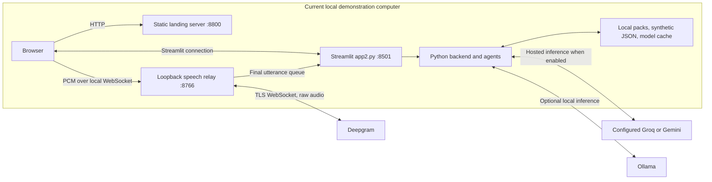
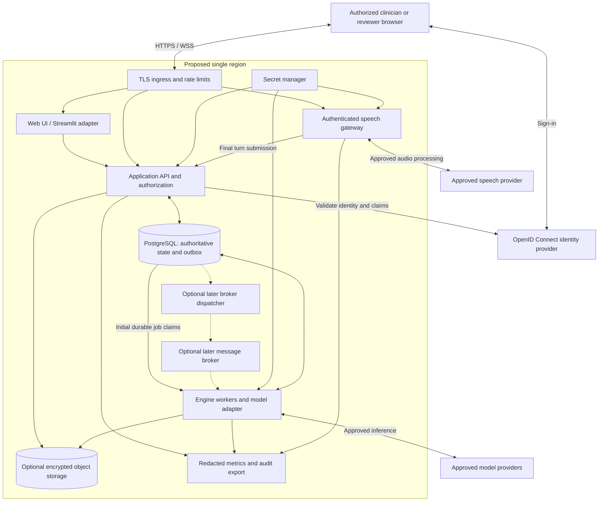

# Operations, dependencies, and roadmap

Reviewed **2026-10-28** against source commit **`b8e1b875809587aaebcde5bf5726ec1407d15264`**. This document describes the current prototype and a proposed route to a controlled multi-user service. Proposed infrastructure, controls, and acceptance criteria are design recommendations, not deployed capabilities or measured service guarantees.

## 1. Current deployment

The application is a Python/Streamlit process with local JSON assets and an optional in-process, threaded speech relay. There is no checked-in container definition, infrastructure-as-code deployment, database migration set, or GitHub Actions workflow at the reviewed commit. Repository inspection does not establish whether an external deployment currently exists.

| Surface | Implemented configuration | Operational consequence |
| --- | --- | --- |
| Landing page | [run.sh](../../run.sh) serves `landing/` with Python's HTTP server on port 8800 | Local demonstration launcher; not a hardened production web server |
| Main console | `run.sh` starts [app2.py](../../app2.py) on port 8501 | The README's direct console command also selects `app2.py` |
| Alternate console | [app.py](../../app.py) is the entry point named in [DEPLOY_AND_STAGE.md](../DEPLOY_AND_STAGE.md) | Maintainers must choose and test an entry point explicitly; the two UIs share backends but are not identical |
| Deepgram relay | [src/stt_deepgram.py](../../src/stt_deepgram.py) binds `127.0.0.1`; default port 8765, overridden to 8766 by `app2.py` unless `STT_PORT` is already set | Browser JavaScript connects to its own loopback address. Remote users cannot reach a relay on the hosted server through that address |
| Visit state | UI backend and `VisitState` in Streamlit session memory | Restart, disconnect, or session replacement can lose work; there is no durable visit recovery contract |
| Model cache | Local `data/llm_cache/` JSON files | Shared process/filesystem scope; not a tenant-isolated production store |
| Demo data | `demo/`, `packs/`, `data/synthetic/`, `data/eval/` | Synthetic fixtures and scripted behavior; these are not a clinical patient database |



This deployment diagram omits the separate role-classification request for readability; that request and its privacy implications are documented in the integration/security design. Selecting a scripted backend or LLM `DEMO` mode does not by itself disable microphone or role-classification network activity. A genuinely offline demonstration must also leave network-backed speech input disabled.

For a public synthetic demonstration, Streamlit Community Cloud remains a documented option. Use a chosen entry point, explicit dependency versions, and the platform's secrets facility. Do not infer remote microphone support from a successful Streamlit page load. The current loopback relay requires redesign for remote access. Streamlit's documentation also requires attention to session affinity when load balancing or replicating an app; session state is tied to its WebSocket connection and resets when the session is replaced. [Streamlit architecture](https://docs.streamlit.io/develop/concepts/architecture/architecture), [Session State limitations](https://docs.streamlit.io/develop/api-reference/caching-and-state/st.session_state), [Community Cloud deployment](https://docs.streamlit.io/deploy/streamlit-community-cloud/deploy-your-app).

## 2. Reproducible contributor setup

Run these commands from the repository root. Python 3.12 is the historically documented baseline; it is a starting point for a tested runtime matrix, not an assertion that every newer Python or package release works.

```powershell
py -3.12 -m venv .venv
.\.venv\Scripts\python.exe -m pip install -r requirements.txt
$env:DRLISTNER_MODE = 'DEMO'
$env:DRL_MODE = 'DEMO'
$env:DRL_BACKEND = 'Scripted'
.\.venv\Scripts\python.exe -m streamlit run app2.py
```

On macOS/Linux, use `python3 -m venv .venv`, `.venv/bin/python -m pip install -r requirements.txt`, then `DRLISTNER_MODE=DEMO DRL_MODE=DEMO DRL_BACKEND=Scripted .venv/bin/python -m streamlit run app2.py`. `app2.py` initializes its UI from `DRL_MODE`/`DRL_BACKEND`; `DRLISTNER_MODE` supplies the core client's default for callers that do not pass a mode. The existing `run.sh` also launches the landing page; it is a Bash script with macOS/Linux browser-opening commands, not a native PowerShell launcher.

Choose **Scripted** for a predictable walkthrough without inference credentials. The **Engine** backend in `DEMO` mode is cache-only: a cache miss is an explicit failure, not permission to call a provider. Typed or scripted synthetic turns are the simplest way to separate engine testing from speech-provider testing.

For development tests, install `requirements-dev.txt` and run `python -m pytest -q` in the environment. The development file includes large optional offline dependencies, including `sentence-transformers`; these need not be deployed with the hosted application. Tests with fakes establish contracts and error handling, not hosted-provider availability or clinical validity.

Score a committed harness fixture without overwriting the repository's saved result files:

```powershell
.\.venv\Scripts\python.exe -m scripts.run_eval --run fake-dev-oracle --split dev --results-root "$env:TEMP\drlistner-architecture-eval"
```

The result remains a **harness check**, not detector accuracy. [eval/README.md](../../eval/README.md) documents run metadata, scoring exclusions, artifact replacement, and dataset limitations. Exporting new engine runs with `scripts.export_run` or invoking `scripts.smoke_llm` is a separate operation: verify selected providers, mode, cost, and synthetic inputs before enabling live calls.

## 3. Configuration and dependency boundaries

| Configuration | Current source/default | Maintenance requirement |
| --- | --- | --- |
| `DRLISTNER_MODE` | [src/config.py](../../src/config.py), `DEMO` | Preserve cache-only failure semantics; label backend and mode separately in test evidence |
| `DRL_MODE`, `DRL_BACKEND` | [app2.py](../../app2.py), `DEMO`, `Scripted` | Explicitly set these for a repeatable app2 walkthrough; they initialize UI session settings |
| `LLM_PROVIDERS` | `groq,gemini,ollama` | Record actual provider used; a fallback can change behavior and data destination |
| `GROQ_MODEL` | `openai/gpt-oss-120b` | Repository default, not a current availability or pricing guarantee |
| `GEMINI_MODEL` | `gemini-2.5-flash` | Verify service availability before a live test; retain model identity in result metadata |
| `OLLAMA_MODEL`, `OLLAMA_URL` | `qwen2.5:7b`, `http://localhost:11434` | Ollama and its model must be provisioned independently; the repository does not install them |
| `GROQ_API_KEY`, `GEMINI_API_KEY` | Environment, then Streamlit secrets via `get_secret` | Keep credentials out of Git and diagnostic output |
| `DEEPGRAM_API_KEY`, `DEEPGRAM_MODEL`, `STT_PORT` | Speech module reads environment; model `nova-3`, port 8765 unless overridden | Test the speech path separately; its configuration access differs from the model wrapper |

The minimal `.env` loader in `src/config.py` reads a gitignored repository-root file and preserves existing environment values. `.streamlit/secrets.toml` is also ignored. Platform deployment should inject secrets rather than commit them; the mechanism is documented by [Streamlit secrets management](https://docs.streamlit.io/deploy/streamlit-community-cloud/deploy-your-app/secrets-management). Ignoring a path does not remove a secret already committed to history.

| Dependency group | Declared constraints at baseline | Risk and recommended control |
| --- | --- | --- |
| UI and transport | `streamlit`, `streamlit-mic-recorder`, `websockets>=13` | Unbounded upgrades can change widget or WebSocket behavior. Produce a tested lock/constraints file and exercise both UIs and speech reconnects before an upgrade |
| Validation and HTTP | `pydantic>=2.6`, `requests` | Pin the tested resolution, including transitive packages; test JSON/schema rejection and provider timeouts |
| De-identification | `presidio-analyzer`, `presidio-anonymizer`, `spacy>=3.8,<3.9` | Package presence is not proof of complete redaction; test false negatives, clinical keep-list behavior, and resource use |
| NLP model | `en_core_web_sm` wheel 3.8.0 via a GitHub release URL | Keep spaCy/model compatibility; include model artifact provenance and integrity in reproducible builds |
| Presentation/evaluation | `textstat`, `pandas` | Readability is a proxy, not a comprehension test; preserve evaluator semantics across upgrades |
| Development/offline | `pytest`, `pypdf`, `scikit-learn`, `sentence-transformers`, `fhir.resources` | Separate runtime from analysis dependencies; remove unused declarations only after import/use review |
| Hosted model and speech APIs | Service names and model IDs in configuration/source | Record endpoint, model, prompt/schema/pack versions and observed rate limits per run; do not copy historical free-tier quotas into service guarantees |

No current-version upgrade is prescribed by this document. Select supported versions through compatibility testing and vulnerability review before release. Deepgram's current documentation deprecates `diarize=true` while retaining v1 behavior; streaming supports `diarize_model=v1` or `latest`, whereas v2 is batch-only. The source still uses the older flag. Treat migration as an integration change requiring a synthetic speech regression, including speaker-to-role corrections. [Deepgram diarization](https://developers.deepgram.com/docs/diarization).

## 4. Proposed deployment infrastructure

**Proposal:** retain a modular Python application, extracting an authenticated API and asynchronous workers around the existing engine. Start in one region. Select a provider only after budget, availability, residency, and operating responsibilities are agreed. Kubernetes and independently deployed services per detector are not prerequisites.



The PostgreSQL jobs/outbox transaction is the initial durable acceptance boundary: commit an authorized turn and its processing/dispatch records together, then acknowledge it. Workers initially claim durable database jobs directly. The dashed broker/dispatcher path is optional later infrastructure, not required for the first target. Workers apply jobs idempotently and preserve processing order for each visit generation. Parallelize across visits, not across mutations of one `VisitState`. A broker is delivery infrastructure, not the source of truth. Provider retries must not duplicate flags, advance turn indices twice, or finalize twice. Track accepted and processed transcript frontiers separately, and give intentional reprocessing a new generation as defined in [the API contract](API-CONTRACTS.md).

Use a private database network, encrypted storage/backups, separate identities for API, workers and migrations, and controlled outbound provider access. Object storage is optional for approved exports or other retained artifacts; **raw-audio retention defaults to off**. Define retention and deletion consistently across primary data, caches, exports, backups, and providers before retaining sensitive data.

Separate development, staging, and production credentials and stores. Staging uses synthetic fixtures and configured test providers. A proposed release pipeline builds one immutable artifact, runs offline tests and schema/diagram validation, scans dependencies and secrets, deploys to staging, performs synthetic end-to-end checks, and promotes the same artifact through a controlled release. Add infrastructure and migrations to version control when implementing this design. No such pipeline or deployment is created by this documentation change.

PostgreSQL row-level security can provide defense in depth for tenant isolation, but table owners and `BYPASSRLS` roles normally bypass it. Use restricted application roles and deliberate policies, and test cross-tenant denial with those actual roles. OpenID Connect establishes user identity; application authorization must still enforce visit access. An EHR connector should use the selected EHR's supported FHIR/SMART contract with read-only scopes initially. FHIR itself does not supply a complete security system. [PostgreSQL RLS](https://www.postgresql.org/docs/current/ddl-rowsecurity.html), [OpenID Connect Core](https://openid.net/specs/openid-connect-core-1_0.html), [FHIR security](https://hl7.org/fhir/security.html), [SMART App Launch](https://www.hl7.org/fhir/smart-app-launch/app-launch.html).

## 5. Reliability, scale, and operating runbook

There is no measured availability, concurrency, throughput, recovery-time, or recovery-point objective in the repository. Before selecting instance sizes or a scaling policy, agree a pilot envelope: concurrent visits, average/max visit duration, peak turns per second, acceptable turn/summary delay, daily cost ceiling, and retention volume. Measure these with synthetic load and record the hardware/runtime, provider settings, and cache hit ratio. Historical laptop memory measurements are not deployment capacity guarantees.

| Signal | Why it matters | Recommended response |
| --- | --- | --- |
| Queue age and per-visit lag | Shows whether turn processing can keep up | Bound backlog, show processing state, pause acceptance when capacity is exhausted; scale workers across visits |
| Provider latency, timeout/429 rate, retries, fallback | Distinguishes inference delay from application failure | Apply deadlines, retry budgets, circuit breakers and approved fallback policy; keep partial analysis visibly incomplete |
| Token/audio usage and estimated cost | Captures the dominant variable costs | Add per-tenant budgets and concurrency limits before increasing worker count |
| Failed/unverified flags and unknown coverage | Prevents outages looking like a clean visit | Display incomplete status; never convert missing results into successful negative findings |
| Role uncertainty and STT reconnects | Role errors can invalidate downstream evidence | Confirm role before accepting a turn; accepted-turn correction is deferred until a reviewed amendment contract exists; monitor without storing raw speech in logs |
| Data retention/deletion backlog and restore checks | Ensures lifecycle controls work | Alert on overdue deletion; test restores with access policies and deletion handling intact |

Use correlation IDs, visit IDs and error codes in operational telemetry. Avoid transcript text, chart text, prompts, model responses and credentials in ordinary logs. Keep quality metrics separate from availability metrics: a healthy HTTP endpoint does not establish that a visit was analyzed correctly.

| Incident or task | Current prototype procedure | Target procedure to implement |
| --- | --- | --- |
| Scripted demo fails | Confirm selected backend/profile and synthetic assets; restart with a new visit | Keep a versioned synthetic smoke case per release |
| `DEMO` cache miss | Record model/configuration and show the error; use the scripted walkthrough if needed | Validate required cache assets before release; do not silently enable network calls |
| Live provider unavailable | Inspect sanitized error state, provider configuration and credentials; preserve unknown/unverified status | Retry bounded jobs; explicitly show delayed/failed analysis; reprocess idempotently after recovery |
| Remote microphone fails | Use typed/scripted input; verify the browser is not trying to reach a hosted service through local loopback | Same-origin WSS gateway, short-lived authorized session, reconnect policy, input sequence IDs and limits |
| Session/server restart | Start a new synthetic visit; there is no durable resume guarantee | Recover from committed visit events; reconnect using authorized last-seen sequence |
| Incorrect speaker assignment | Correct the demo's speaker mapping; do not assume diarization identifies clinical roles | Confirm before acceptance. Start a new synthetic visit for accepted-content mistakes until the deferred amendment API defines versioned correction and recomputation |
| Rollback | Re-run the prior reviewed code and compatible assets | Deploy previous immutable artifact; use backward-compatible migrations and versioned prompt/pack configuration |
| Backup/restore | Repository restores code and committed fixtures only | Test encrypted database/object restores; document approved RPO/RTO and verify tenant controls after restore |

Do not replay events from a deleted or consent-revoked visit merely because they remain in a queue or restored backup. The worker must recheck current visit lifecycle state before processing or calling a provider. Retention exceptions and backup expiry need a documented owner and schedule.

## 6. Staged roadmap and acceptance criteria

Priority reflects dependency order; dates and staffing are not assumed.

| Stage | Work | Acceptance evidence |
| --- | --- | --- |
| **P0: reproducible synthetic prototype** | Select/document the supported UI entry point; constrain tested dependencies; reconcile stale docs; add STT contract tests and a predictable offline walkthrough | Fresh-environment setup succeeds; offline suite passes; scripted end-to-end walkthrough works with speech/network disabled; mode/backend behavior and known failures are visible |
| **P0: close privacy and isolation gaps** | Route all hosted text through an approved processing boundary; isolate speech/session resources; define consent and allowed data; remove assumptions that schema flags prove synthetic content | Negative tests for cross-session leakage, unauthorized WebSocket access and revoked sessions; no unapproved hosted call path; explicit data-flow review |
| **P1: authenticated durable service** | Implement API, identity/authorization, authoritative visit storage, outbox/jobs, versioning, idempotency and ordered mutations | Concurrent/retried turns cannot duplicate or reorder accepted state; restart/resume works; cross-tenant and cross-visit access denied; integration contracts and migrations versioned |
| **P1: operations and recovery** | Add reproducible deployment, secrets, audit metadata, load tests, budgets, alerts and backup/restore | Synthetic staging release, rollback and restore rehearsed; chosen latency/capacity/cost/RPO/RTO targets documented with measurements |
| **P2: independent quality validation** | Clinician review of checklist/wording; independent synthetic and consented validation design; speech/role/accent/noise cases; summary factuality and accessibility evaluation | Versioned reviewed packs; held-out evaluation with counts and uncertainty; clear false-positive/negative analysis; no claimed improvement without saved evidence |
| **P2: restricted EHR pilot** | Read-only FHIR/SMART adapter, patient-context verification, chart snapshot provenance, consent and appropriate provider agreements | EHR sandbox tests; scope and patient-context errors denied; security, privacy and clinical stakeholders approve the defined pilot |
| **P3: controlled enhancements** | Vetted education retrieval for summaries, clinician-reviewed pack authoring, additional conditions/languages, improved clarify/decision extraction | Source licenses and revisions recorded; cited explanations checked; retrieval cannot silently change gap definitions; each new pack/language has separate validation |

The historical precision/recall targets of at least 80%, at most one false flag per visit, and grade-6 summaries are research goals, not release evidence. Preserve per-type TP/FP/FN counts, confidence intervals and error cases; do not interpret the small authored dataset as clinical validation. Grade and word-limit targets are profile-driven, and a best-of-three rewrite can still miss them. Require clinician review of patient-facing summaries before any real clinical use.

Future retrieval must remain outside the runtime gap criteria: use fixed, versioned checklist packs for detection, and use vetted retrieved content only for approved explanatory material or offline pack authoring. A separate ClarifyAgent or DecisionsAgent is optional future implementation; the current UI's clarify view does not prove those standalone agents exist. Maintain quiet interaction, evidence links, accessible text/contrast, and at most three clarify items as product constraints.

## 7. Historical documentation reconciliation

These older artifacts remain useful for purpose and requirements. Their implementation-status statements must not override the reviewed source.

| Source | Retain | Reconcile when maintaining it |
| --- | --- | --- |
| [Project report](../PROJECT_REPORT.md) | Accessibility focus, four gap types, quiet surfacing, evidence, summary and evaluation goals | Its UI section says no `app.py`, while a later table says it is built; Web Speech/faster-whisper descriptions do not describe every current Deepgram path; fixed quotas/costs are historical assumptions |
| [Progress log](../../PROGRESS.md) | Incremental evidence, dataset limitations, lack of clinician review | Claims that there is no evaluator/UI or model wheel are stale; it is a historical log, not a current capability inventory |
| [Original SRS](../../Project-SRS.docx) | Documentation completeness, patient accessibility and prototype scope | Three-gap, after-visit-only design is superseded by the later four-gap/turn-based specification |
| [Earlier architecture DOCX](../Dr.Listner%20architecture%20document.docx) | Deterministic orchestration, narrow agents, verification, future signed packs and restricted retrieval role | It explicitly based status on docs without inspecting source. Gateway, audit, monitoring, signed registry, RAG, ClarifyAgent and DecisionsAgent are proposals; UI/evaluator/STT status is outdated |
| [Version 2 proposal PDF](../Dr.Listner%20project%20proposal,%20version%202.pdf) | Synthetic-only phase boundaries, four-gap semantics, evidence and evaluation discipline | Oct 21 phase deadlines and “not started” status are historical; no clinical validation or deployed platform is established by this proposal |
| [Deploy/stage checklist](../DEPLOY_AND_STAGE.md) | Scripted fallback and pre-presentation rehearsal | `app.py` entry point differs from current README/launcher; local RAM and cloud sleep figures are not current capacity evidence |

When changing runtime behavior, update the architecture pages, the normative schema/spec where appropriate, and contributor-facing setup together. Record source commit, date, decision owner, alternatives and migration impact for a new architecture decision. Keep historical evidence identifiable rather than rewriting a prior measurement as though it applied to a new release.

Diagrams are maintained as text in Markdown. GitHub supports fenced `mermaid` blocks in repository Markdown and pull requests; use conservative syntax and validate/render after editing. [GitHub diagram documentation](https://docs.github.com/en/get-started/writing-on-github/working-with-advanced-formatting/creating-diagrams).
