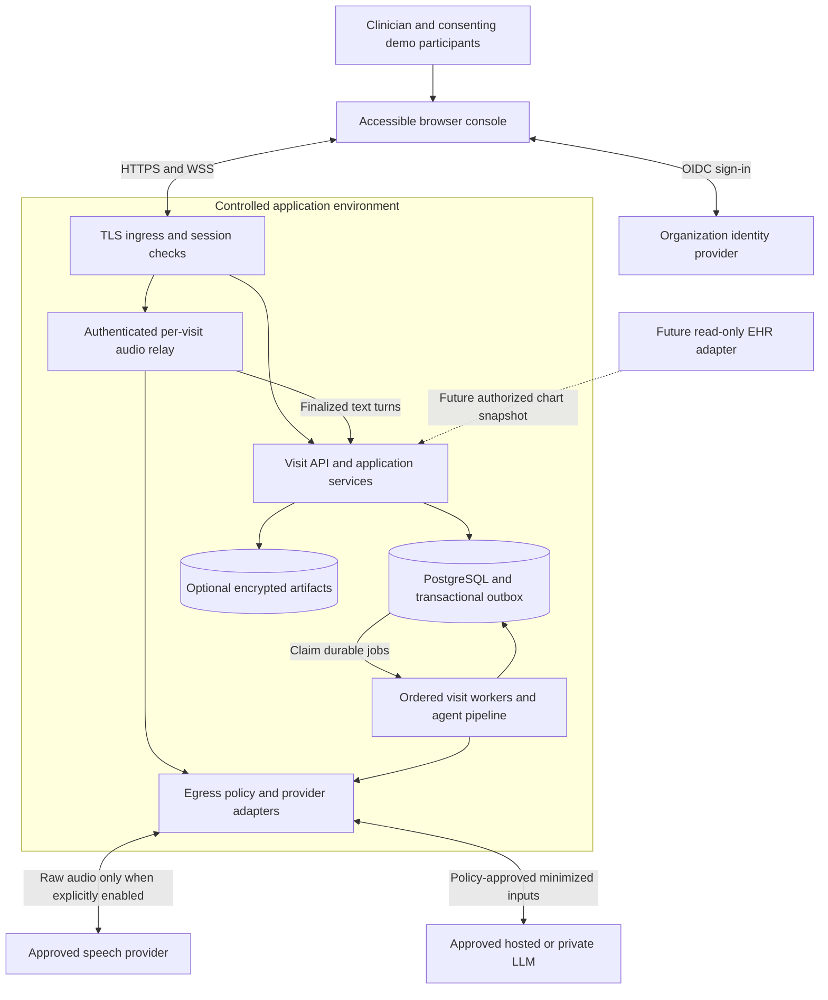
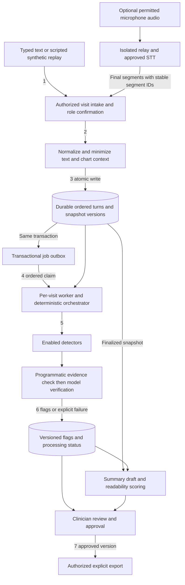
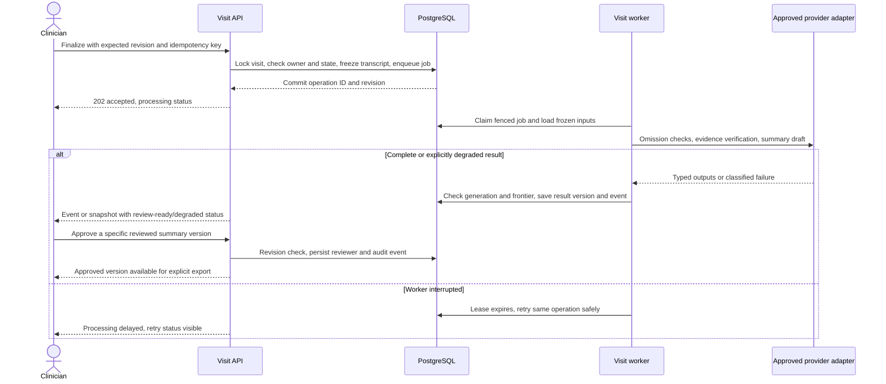

# Solution design

**Status:** proposed evolution of the reviewed prototype. **Baseline:** `b8e1b875809587aaebcde5bf5726ec1407d15264`, reviewed 2026-10-28. Read [CURRENT-SYSTEM.md](CURRENT-SYSTEM.md) for implemented behavior.

## Scope and design approach

Dr. Listener helps a clinician notice communication gaps and prepare an accessible consultation summary. The four detector types are missed questions, unanswered concerns, chart contradictions, and comprehension breakdowns. The clinician remains responsible for reviewing findings and the summary. The architecture does not introduce diagnosis, treatment recommendation, autonomous chart updates, or clinical deployment approval.

Retain a **modular Python application with ports and adapters**. Preserve the deterministic orchestrator and typed agent boundaries, then add authenticated transport and durable storage around them. Separate the API, long-running processing worker, and audio relay into deployable processes where their concurrency and connection lifetimes require it. They can share one repository and release version. A microservice per agent would add distributed consistency and operational costs without evidence that the prototype needs it.

The first target remains synthetic-only. Any non-synthetic pilot is a separate release gate requiring ownership, permitted-use, consent, privacy, clinical, and operational decisions. The proposed infrastructure is a design, not a compliance certification.

## System context and trust boundaries

**PROPOSED.** Solid arrows identify intended communications, not implemented connections. A future EHR adapter is isolated and read-only initially; the current project only imports synthetic FHIR bundles offline.

The browser is an untrusted client. The service checks identity, tenant membership, visit authorization, payload limits, and workflow state on every action. Provider boundaries are external data disclosures: sending audio to speech recognition occurs before text de-identification and needs its own explicit policy. An approved text provider is not automatically an approved audio provider.

## Component responsibilities

| Component | Responsibility and state ownership | Relationship to current code |
| --- | --- | --- |
| Browser console | Input, passive live indicators, evidence review, accessible summary, clear outage status; no provider credentials | Preserve UX intent of `app2.py` / `app.py`; Streamlit may remain a synthetic admin/demo client |
| API / application service | Authenticate and authorize commands; validate turns; own visit lifecycle, revision checks, transactional writes and outbox | New adapter around `src/engine.py` and `src/schemas.py` |
| Audio relay | One authenticated connection per permitted capture stream; backpressure, audio limits, ephemeral buffers, reconnect state | Replace process-global `LiveSTT`; retain speech integration concepts |
| Input and privacy adapters | Validate synthetic provenance controls; normalize chart/turns; apply redaction and approved egress policy | Extend `src/deid.py`; remove bypasses rather than trusting a schema marker |
| Worker and orchestrator | Claim one ordered job per visit; load immutable input snapshot; execute enabled agents; save versioned results | Reuse deterministic fold in `src/engine.py`; external I/O remains behind interfaces |
| Detection and verification | Return typed candidates, check evidence, reject unsupported claims; distinguish failure from negative result | `src/agents/`; preserve timing and evidence semantics |
| Summary application service | Generate versioned draft from the finalized transcript and accepted evidence; track readability and clinician approval | Extend `SummaryAgent`; clinical approval is new, independent of model verification |
| Persistence adapter | PostgreSQL authority for visits, turns, result versions, review actions, durable jobs and audit metadata | Replaces memory/files for service workloads; keeps synthetic fixtures for tests |
| Provider adapters | Policy-approved model selection, timeouts, retry budgets, provenance, bounded cache and circuit breaking | Consolidate `src/llm/client.py` and direct STT role-classification requests |
| Evaluation tooling | Frozen datasets, provenance, reproducible runs, detector and summary quality reports | Retain `eval/` and `scripts/`; isolate from runtime identity and credentials |

The service does not delegate permission checks, lifecycle transitions, or persistence commands to an LLM. Transcript and chart text are untrusted data even when the model is told to treat them as evidence.

## End-to-end data flow

**PROPOSED.** Numbered edges show the main path; audio is optional. Raw audio is transient by default and never stored merely because speech recognition is enabled.

1. Create an authorized synthetic visit and select a versioned checklist/profile. A chart snapshot is immutable for a processing generation.
2. Accept a typed/scripted turn or finalized speech segment. Speaker diarization yields anonymous speaker labels, not clinical roles; show role uncertainty and require role confirmation before accepting a turn. Correction of already accepted turns is deferred by the [API contract](API-CONTRACTS.md); start a new synthetic visit until an amendment contract exists. A future amendment must create a new transcript revision and recompute affected results without changing historical evidence.
3. Validate and minimize at a defined intake boundary. Commit an accepted turn, its sequence/version, an audit record, and the processing job together. An API acknowledgment means durable acceptance, not completed analysis.
4. Process ordered jobs under a visit lease or row lock with fencing. One worker owns state mutation for a visit at a time. Track the latest accepted transcript revision separately from the processed-through revision for the active processing generation. A valid ordered prefix result remains usable when new turns arrive; it advances the processed frontier and the UI shows remaining lag. Independent visits can run concurrently; independent detector calls for a fixed snapshot may run in bounded parallelism, with deterministic result merging.
5. During the visit, evaluate chart contradictions and comprehension cues. Keep missed-question and unanswered-concern detection at finalization. Preserve quiet indicators and no disruptive pop-ups.
6. Persist model/provider, prompt/schema/pack versions, input revision, verification state and errors with outputs. Failed checks show **analysis incomplete**. An empty flag set is not proof that a visit has no communication gaps.
7. Finalize, generate a summary draft, review, and explicitly export the approved version. A generated summary does not become an approved clinical record by passing a readability test.

## Finalization and review

**PROPOSED.** Finalization locks the accepted transcript version. The worker waits for prior turn jobs or folds the complete immutable prefix itself; it must never finalize a partial transcript accidentally.

Provider failures cannot approve a summary. Degraded results may remain reviewable, but any approval requires the clinician to acknowledge their incomplete analysis state. A retry of the same operation retains its generation and idempotency identity; an intentional reprocess creates a new processing generation, even for unchanged transcript/model versions. Every new generation requires renewed approval, even when text is unchanged. A valid policy-scoped inference cache may be reused; reprocess promises a new analysis operation, not a fresh paid provider call. Historical approved versions remain identifiable for authorized review, but the initial export API exports only the current generation's approved summary. Reprocessing disables new exports until that generation is approved; already downloaded files cannot be recalled.

## Persistence and consistency

Use PostgreSQL as the target transactional authority; see the [logical database model](DATA-AND-SECURITY.md). JSONB can hold immutable validated schema snapshots and provider metadata, while indexed relational keys enforce visit ownership and ordering. Do not treat arbitrary JSON blobs as a substitute for tenant-scoped foreign keys and unique constraints.

Initially, use a durable jobs/outbox table and leased workers. A message broker is optional later; if added, publish from the committed outbox and tolerate at-least-once delivery. A queue is not the source of truth for visit state. Cache keys include tenant, approved provider/model version, input digest, prompt/schema/pack version, and policy version. Cache writes must be atomic, bounded and expiring; use no cross-tenant shared response cache for sensitive data.

Deduplicate accepted commands and results, not just text. Use `(tenant_id, visit_id, idempotency_key)` for mutations and `(tenant_id, visit_id, processing_generation, target_transcript_revision, job_type, algorithm_version)` for jobs. A reused key with different payload returns a conflict. Each intentional reprocess increments the processing generation; retries within it reuse the same logical jobs.

For a per-turn job, atomically verify the active generation, lease token, expected prior processed-through revision, and that the target prefix is still accepted. Advance the frontier in order, even if intake has accepted later turns. Do not reject a valid prefix simply because its revision is below the accepted frontier. Finalization requires the frontier to reach the frozen accepted revision (or an equivalent full-prefix fold) and commits to that generation only. A superseded generation, invalid lease, revoked/deleted visit, or already-advanced processing frontier rejects stale work. Expose accepted and processed frontiers together so lag never appears as complete analysis. Exactly-once provider billing is not promised: a timeout may leave a paid external call whose result the worker did not receive.

## Scalability and reliability

Scale on measured bottlenecks: concurrent audio connections, queue age, provider token budgets, per-turn latency, summary completion time, CPU/memory, and database connection pressure. First bound admission and provider concurrency. Extra web replicas do not fix upstream rate limits or unbounded model call chains.

Keep speech connections sticky to their relay for connection lifetime, with external authoritative visit state. Reconnect by authenticated visit and last accepted segment; never replay raw buffers without deduplication. Bound audio duration, frame size, idle time, queued turns, and per-tenant spending. Use bulkheads so evaluation batches cannot consume interactive processing capacity.

Use timeout budgets and exponential backoff with jitter for transient provider failures, respect supported `Retry-After`, and stop retrying invalid authorization/policy failures. Make degraded status persistent. An alternative provider is usable only if it is approved for the data class and preserves required output semantics. Avoid a fallback that silently changes data residency or disclosure rules.

No throughput or availability guarantee is asserted. Establish service objectives after measuring representative synthetic workloads; see [operations gates](OPERATIONS-AND-ROADMAP.md). Add multi-region operation only when recovery objectives, legal data locations, and measured load justify the consistency burden.

## Architectural alternatives and rationale

| Decision | Recommendation | Alternative and revisit condition |
| --- | --- | --- |
| Application shape | Modular Python application, explicit adapters, API/worker/relay processes | Per-agent microservices only if separately owned scaling or release needs emerge |
| UI | Keep Streamlit for prototype; define service contracts before choosing a production browser client | A dedicated web client if accessibility, capture, offline/reconnect, or session controls exceed Streamlit's fit |
| State | PostgreSQL plus optional artifact storage | Files remain sufficient for synthetic fixtures; they do not support concurrent authorized durable service state |
| Jobs | Transactional jobs/outbox with per-visit ordering | Dedicated broker when measured queue throughput and operations require it |
| Inference | Approved provider adapters with explicit policy and evaluation | A private model endpoint if privacy or latency requires it, after quality and capacity validation |
| Retrieval | Defer; use only approved versioned sources for explanatory material initially | Runtime retrieval requires evidence provenance, prompt-injection controls, and independent quality tests |
| Infrastructure | Managed single-region services and infrastructure as code, vendor open | Kubernetes or multi-region only after operational requirements support their cost |

These are recommendations, not approved purchases or newly installed dependencies. Named service capabilities are supported by the official references in [operations](OPERATIONS-AND-ROADMAP.md); exact new runtime and database versions must be pinned and tested when implementation begins.

## Requirements traceability

| Capability | Current anchor | Target owner / acceptance evidence |
| --- | --- | --- |
| Four communication gap types | `src/schemas.py`, `src/agents/`, `src/engine.py` | Agent pipeline; frozen dev/test evidence, timing and citation tests |
| Quiet visit, focused wrap-up | `app.py`, `app2.py`, `SPEC.md` | Console and lifecycle service; no early omission alerts and accessibility review |
| Hearing/literacy/caregiver personalization | `PatientProfile`, `packs/chest_pain/profiles/` | Versioned profile snapshot; behavior and summary limits tested per profile |
| Evidence-backed findings | `VerifierAgent`, `EvidencePointer` | Immutable result revisions and visible source references; malformed/stale evidence rejected |
| Plain-language summaries | `SummaryAgent`, summary scoring scripts | Versioned clinician-approved draft; readability plus factual/plan coverage review |
| Live speech | `src/stt_deepgram.py` | Isolated authenticated relay; role correction, disconnect and cross-session tests |
| Chart integration | Synthetic FHIR importer | Future constrained read-only adapter; patient/encounter matching and provenance tests |
| Persistent audit and access control | Not implemented | API, data and identity adapters; tenant-denial and reviewer-attribution tests |
| Contributor-maintained design | This package | Linked docs, editable diagrams, stable decisions, validation record and reviewed PRs |

## Open decisions before later phases

The owner must select deployment organization/cloud and budget, define data classes and permitted providers, decide jurisdiction and retention/deletion policies, identify clinical and privacy reviewers, and set recovery and service objectives. The project also needs a chosen identity provider and a decision about whether Streamlit remains the user-facing UI. These are explicit implementation gates, not assumed production capabilities.
